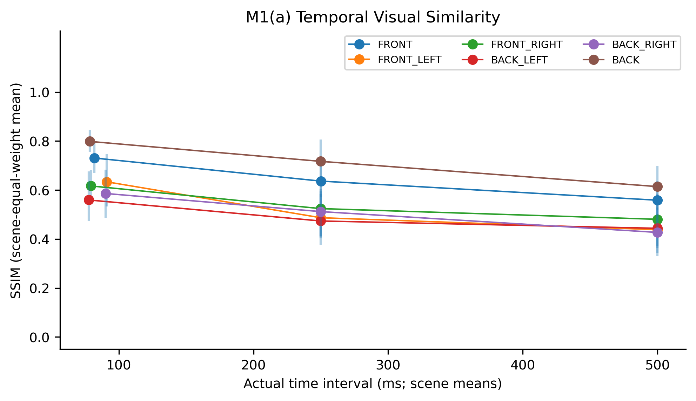
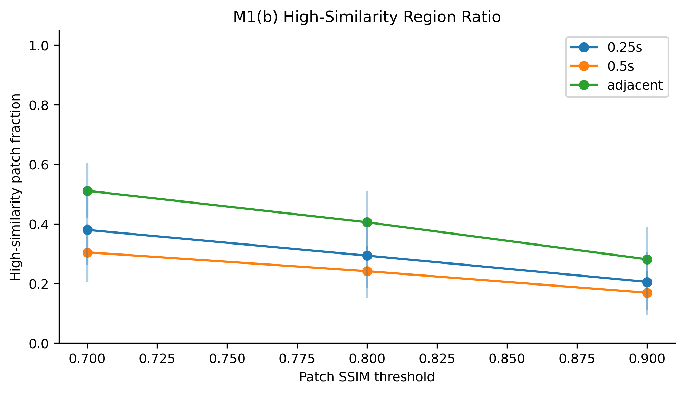
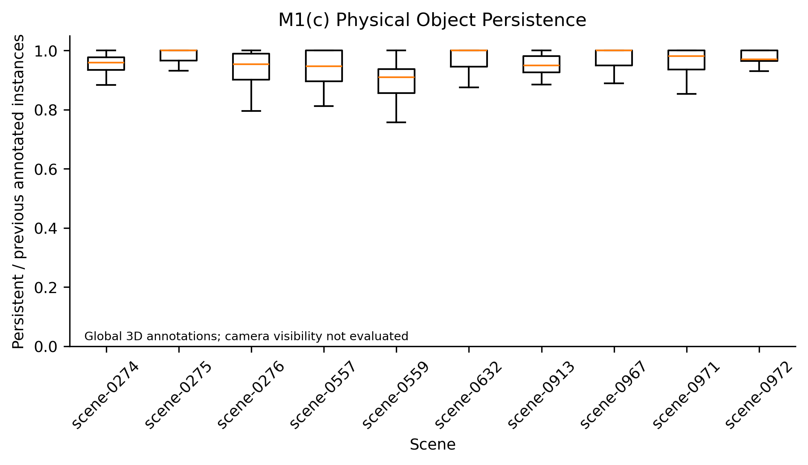
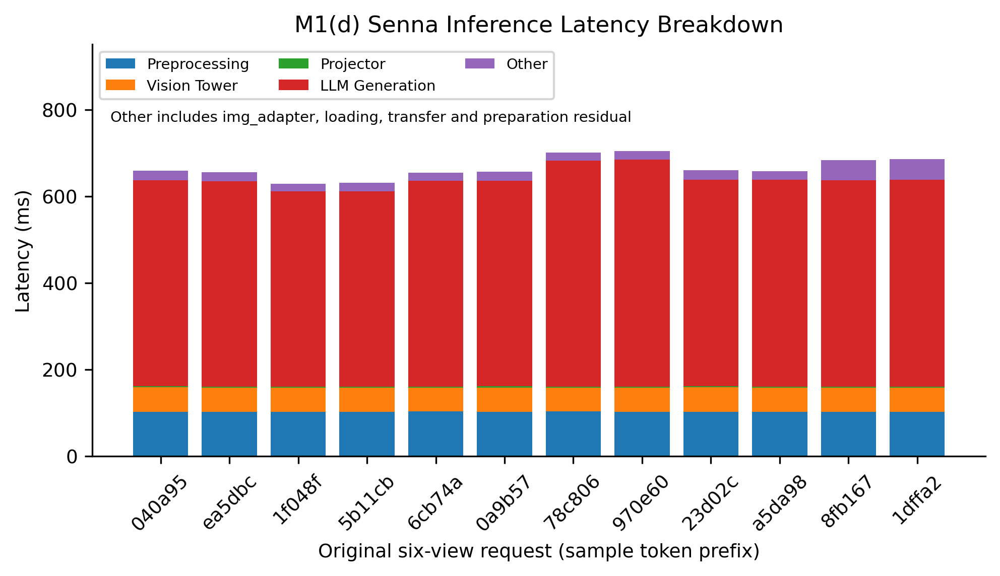
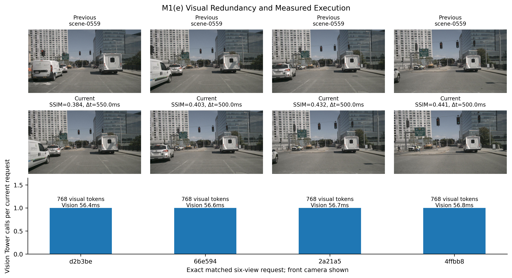
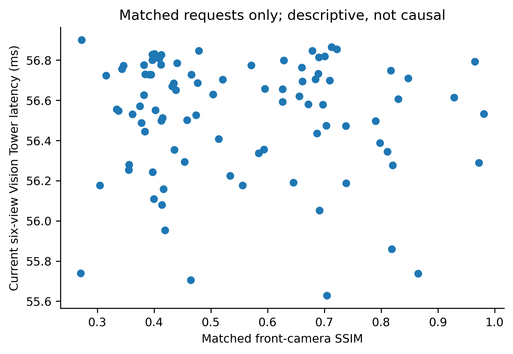

# WorldStream Motivation Experiment 1

## Hypothesis and scope

Continuous driving observations may contain persistent visual content while the original request-based VLM repeats visual encoding. This experiment measures existing behavior only; it implements no WorldStream mechanism. Similarity, persistence and cost are measured independently except for explicitly verified matched records.

## Reproduction and provenance

- Senna commit: `31a3a2336e9494c254b612665fe55e95f67e9cae`; local source SHA256 hashes and working-tree changes are recorded in `run_metadata.json`.
- Checkpoint: `/data/qh/phdCode/work4/models/Senna`; original base weights, no LoRA or weight changes.
- nuScenes: `v1.0-trainval` at `/data/qh/nuscenes/v1.0-trainval`.
- Evaluation JSON: `/data/qh/phdCode/work4/Senna/data/senna_nusc_val_plan_corrected.json`; SHA256 `5d974da8bffd6bd2668efb9fd92ea4b7c7f906a429016597dfd4ddc51b176c5b`.
- Seed: 42; resolved settings in `resolved_config.yaml`.
- Python: `3.10.22 (main, Oct  1 2026, 20:14:04) [GCC 14.3.0]`.
- Camera order: `CAM_FRONT, CAM_FRONT_LEFT, CAM_FRONT_RIGHT, CAM_BACK_LEFT, CAM_BACK_RIGHT, CAM_BACK`.
- Local fork contains corrected camera ordering/navigation and validated evaluation inputs. The experiment invokes this local `eval_multi_img_model_wo_init` directly. Official reference: https://github.com/hustvl/Senna.

## Workload and indexing

`sample_data.next` is followed separately for all six cameras, including non-keyframe sweeps. Scene boundaries, calibrated sensor channels, cycles, file existence, reciprocal links and timestamp anomalies are checked. The first gap group uses direct adjacent links; remaining targets use nearest actual timestamps within the configured tolerance. Pairs are selected with seeded content-independent hashes, round-robin over Scene/Camera/gap strata.

| Quantity | Recorded count |
|---|---:|
| indexed_scenes | 10 |
| indexed_images | 13857 |
| present_images | 13857 |
| non_key_frames | 11439 |
| selected_pairs | 500 |
| valid_pairs | 500 |
| failed_pairs | 0 |
| global_annotation_pairs | 393 |
| profile_samples | 100 |
| profile_repeats | 300 |
| matched_front_pairs | 90 |

## Image-space similarity

Analysis-only resize: `[320, 192]` pixels; patch grid: `[8, 8]`. SSIM uses RGB channel averaging, Gaussian local moments (11×11, sigma 1.5, population covariance) and valid interior pixels. Small patches use a documented smaller odd window. PSNR uses peak=1 after division by 255; identical images have +infinity PSNR. Infinite values are excluded from finite PSNR quantiles, with identical-pixel cases retained in raw CSV. Normalized pixel difference is mean absolute RGB difference in [0,1].

Unweighted mean of within-scene means; 95% percentile bootstrap over scene means. CI undefined with <2 scenes. Latency percentiles describe recorded requests/repeats, not independent scene samples.

| Camera | Gap | Pairs | Scenes | Actual Δt ms (scene mean) | SSIM scene mean | Scene bootstrap 95% CI |
|---|---|---:|---:|---:|---:|---|
| CAM_BACK | 0.25s | 29 | 10 | 250 | 0.717 | [0.6226, 0.8066] |
| CAM_BACK | 0.5s | 28 | 10 | 500 | 0.6141 | [0.5202, 0.698] |
| CAM_BACK | adjacent | 29 | 10 | 78.33 | 0.7984 | [0.7545, 0.8455] |
| CAM_BACK_LEFT | 0.25s | 27 | 10 | 250 | 0.4735 | [0.3766, 0.5943] |
| CAM_BACK_LEFT | 0.5s | 29 | 10 | 500.1 | 0.4436 | [0.362, 0.5291] |
| CAM_BACK_LEFT | adjacent | 26 | 10 | 77.5 | 0.5593 | [0.4742, 0.6755] |
| CAM_BACK_RIGHT | 0.25s | 28 | 10 | 250 | 0.5118 | [0.4109, 0.6039] |
| CAM_BACK_RIGHT | 0.5s | 27 | 10 | 500 | 0.4269 | [0.3431, 0.5015] |
| CAM_BACK_RIGHT | adjacent | 27 | 10 | 90 | 0.5859 | [0.4871, 0.6835] |
| CAM_FRONT | 0.25s | 30 | 10 | 250.1 | 0.6364 | [0.5704, 0.7073] |
| CAM_FRONT | 0.5s | 26 | 10 | 500 | 0.5584 | [0.4788, 0.6371] |
| CAM_FRONT | adjacent | 29 | 10 | 81.71 | 0.7307 | [0.6687, 0.7989] |
| CAM_FRONT_LEFT | 0.25s | 27 | 10 | 250 | 0.4868 | [0.4029, 0.5825] |
| CAM_FRONT_LEFT | 0.5s | 29 | 10 | 500 | 0.4381 | [0.3301, 0.551] |
| CAM_FRONT_LEFT | adjacent | 27 | 10 | 90.83 | 0.6336 | [0.5329, 0.747] |
| CAM_FRONT_RIGHT | 0.25s | 28 | 10 | 250 | 0.524 | [0.4096, 0.6444] |
| CAM_FRONT_RIGHT | 0.5s | 25 | 10 | 500 | 0.4804 | [0.3731, 0.5822] |
| CAM_FRONT_RIGHT | adjacent | 29 | 10 | 79.09 | 0.6167 | [0.5445, 0.6823] |

All PSNR, normalized difference and patch threshold statistics, including confidence intervals, are in `scene_statistics.csv` and `aggregate_summary.json`. Thresholds are sensitivity analyses; high patch similarity is not object identity or a FLOPs-saving fraction.

## Annotated physical instance persistence

Scope: global official 3D annotations at adjacent keyframes. Persistence ratio = size(intersection of instance tokens) / previous instance count; an empty previous set is undefined. Jaccard is also recorded. These are neither per-camera visibility estimates nor fabricated sweep annotations.

393 annotated keyframe pairs, 10 scenes; scene-equal persistence mean 0.9531, scene bootstrap 95% CI [0.9374, 0.9673].

## Original Senna architecture and runtime

Actual entry: `llava/model/builder.py::load_senna_pretrained_model` → `SennaLlavaLlamaForCausalLM`, with the implementation in `llava/senna/`, rather than generic `llava/model/llava_arch.py`. CLIP ViT-L/14-336 selects layer -2 patch features (576 tokens per image). Each of six views passes through the MLP Projector and the original img_adapter (128 tokens per image, 768 total). These are confirmed at runtime by recorded module shapes rather than assumed in the statistics.

Read-only module hooks surround `get_vision_tower()`, `get_model().mm_projector` and `get_model().img_adapter`. Temporary transparent wrappers time loading/preprocessing and bracket multimodal preparation and `generate()`. All attributes/hooks are restored even on exceptions. LLM KV cache remains within each generation request; no visual state crosses requests.

Single-device stage durations use CUDA events on the current stream. They include stream idle/CPU-dispatch gaps between events, and are not pure kernel-only costs. Preparation and generation are parent intervals: exclusive preparation = preparation − Vision − Projector − adapter; LLM generation = generation − inclusive preparation. End-to-end uses synchronized wall clock and includes loading, preprocessing, transfer, prompt processing and answer decoding. Other is its residual. No prefill/decode split is inferred. Multiple-device models get synchronized wall time and metadata, with unreliable stage decomposition left unavailable. Detailed Profiler records are excluded from latency summaries.

Model load: 2.042e+04 ms (excluded from steady-state results). GPU: `NVIDIA GeForce RTX 3090`. Warmup iterations: 10; repeats per request: 3; max new tokens: 64; temperature=0, beam=1, template=llava_v1, use_cache=True.

Output equivalence: 2/2 fixed samples passed exact token IDs, decoded answers, prediction plans, input tensor hashes and generation configuration checks.

| Stage/metric | Finite records | Mean | P50 | P95 | P99 |
|---|---:|---:|---:|---:|---:|
| image_file_loading_ms | 300 | 43.65 | 18.35 | 121 | 184.6 |
| image_preprocessing_ms | 300 | 102.7 | 102.4 | 105.1 | 107.7 |
| host_to_device_ms | 300 | 0.6065 | 0.6022 | 0.6234 | 0.69 |
| vision_tower_ms | 300 | 56.48 | 56.55 | 57.05 | 57.13 |
| projector_ms | 300 | 2.457 | 2.46 | 2.49 | 2.492 |
| img_adapter_ms | 300 | 0.2659 | 0.2664 | 0.2696 | 0.2701 |
| multimodal_preparation_ms | 300 | 0.6872 | 0.6796 | 0.7418 | 0.7853 |
| llm_generation_ms | 300 | 478.8 | 479.8 | 525.8 | 527.6 |
| other_ms | 300 | 1.274 | 1.274 | 1.321 | 1.359 |
| end_to_end_ms | 300 | 687 | 663.2 | 770 | 833.5 |
| vision_latency_ratio | 300 | 0.08258 | 0.08504 | 0.08875 | 0.08935 |
| projector_latency_ratio | 300 | 0.003592 | 0.003712 | 0.003869 | 0.003902 |
| visual_path_latency_ratio | 300 | 0.08656 | 0.08917 | 0.09303 | 0.09366 |
| llm_generation_latency_ratio | 300 | 0.6995 | 0.7227 | 0.7413 | 0.7449 |
| ideal_visual_path_speedup_bound | 300 | 1.095 | 1.098 | 1.103 | 1.103 |

`profile_scene_statistics` in `aggregate_summary.json` records scene-level latency confidence intervals. Request output lengths exclude the artificial initial BOS token in the inspected inputs_embeds generation path; returned sequence length and BOS removal are also recorded. Shapes, allocated/reserved GPU peaks and call counts are in `profiling_samples.csv`. The ideal bound removes measured Vision + Projector + adapter time at zero added management cost; it is not a measured or attainable speedup.

Recorded input_shape: `[1, 6, 3, 336, 336]`.

Recorded vision_tokens_per_image: `576`.

Recorded visual_tokens_total: `768`.

Recorded output_tokens: `11, 8, 9`.

Peak allocated memory on cuda:0: 14.337 GiB (includes resident weights; per-request peaks in CSV).

## Figures and matched workload

Similarity and original inference use distinct input sources. Sample-level comparisons use only `matched_profile_pairs.csv`, which verifies sample tokens and all six exact image paths against the keyframe manifest. Front-camera similarity is an explanatory covariate of the same six-view request, not a camera-specific latency measurement. No correlation is inferred from unrelated averages.

[Vector PDF](figures/M1a_temporal_similarity.pdf). Availability: True. 

[Vector PDF](figures/M1b_patch_similarity.pdf). Availability: True. 

[Vector PDF](figures/M1c_object_persistence.pdf). Availability: True. 

[Vector PDF](figures/M1d_latency_breakdown.pdf). Availability: True. 

[Vector PDF](figures/M1e_repeated_execution.pdf). Availability: True. Exact six-camera sample_data linkage required

[Vector PDF](figures/matched_similarity_latency.pdf). Availability: True. 

M1(d) Other includes img_adapter, loading, transfer, exclusive preparation and residual costs. Parent timings are never stacked with their children. M1(e) has no fabricated values when exact linkage is absent.

## Missing data, anomalies and limitations

- aggregate: complete; 
- index: complete; 
- objects: complete; 
- plot: complete; 
- profile: complete; 
- redundancy: complete; 
- report: complete; 
- manifest_issues: 7 recorded issues; inspect `manifest_issues.json`.
- similarity_issues: 0 recorded issues; inspect `similarity_issues.json`.
- object_issues: 0 recorded issues; inspect `object_issues.json`.
- matched_profile_issues: 0 recorded issues; inspect `matched_profile_issues.json`.
- CPU OS page cache is not flushed; file-loading cost reflects the warm workload. Instrumentation has small overhead; detailed tracing is kept separate.
- Scene bootstrap with few scenes is exploratory; a smoke test establishes executability, not a representative workload claim. No hypothesis significance or practical-cost threshold is predeclared.
- Camera exposure timestamps are asynchronous. Temporal similarity is camera-specific; global annotations use sample timestamps.
- Scene selection prefers the configured evaluation workload when scene tokens are available. Results describe that sampled population.

## Observation Supported by Evidence

Measured group-level scene-mean SSIM spans 0.4269–0.7984; the tables and M1(a/b) quantify content similarity and its variation with actual interval and camera. The measurements, rather than a preset redundancy assumption, determine the observation.

Global annotated instances persist at the recorded ratio of 0.9531; camera-visible persistence remains unmeasured.

All 300 recorded low-overhead requests execute 1–1 Vision Tower calls; runtime shapes/call counts establish repeated encoding for these requests. Vision latency fraction mean is 0.08258; its practical importance must be judged against the measured end-to-end cost and workload variability.

For each recorded input shape, `input_shape_groups` reports encoding token counts and latency. Fixed token counts establish a fixed encoding scale in the tested inputs; they do not establish that runtime cost is independent of scene content. The hypothesis receives evidence only for the recorded components and sampled workload.

## Claims Not Established

- Image similarity does not establish direct reuse of visual features.
- Persistent annotated objects do not establish that all visual encoding is redundant.
- World Alignment benefits have not been demonstrated.
- Incremental inference GPU speedups have not been demonstrated.
- Deadline misses have not been demonstrated.
- No new WorldStream mechanism has been evaluated.
- Statistical association is not causation, and separate dataset averages do not establish per-request correlation.
