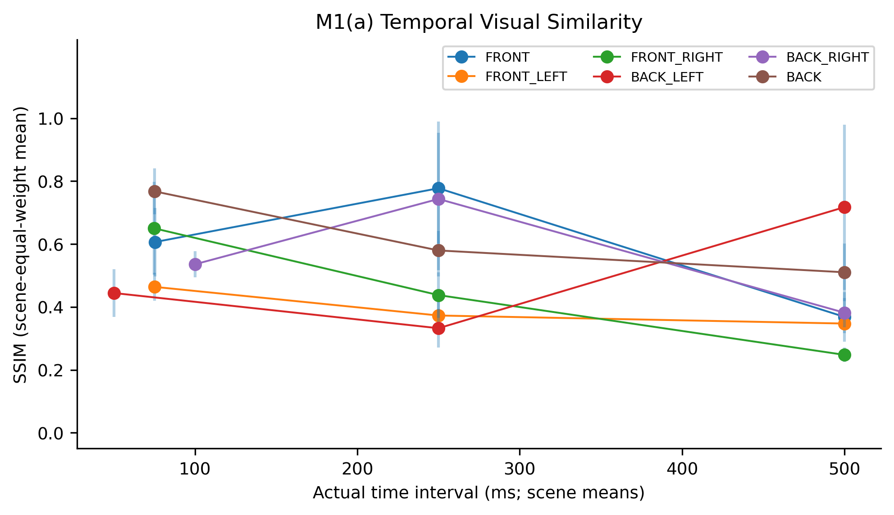
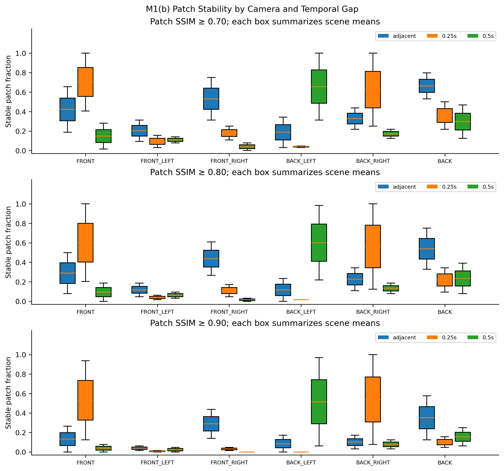
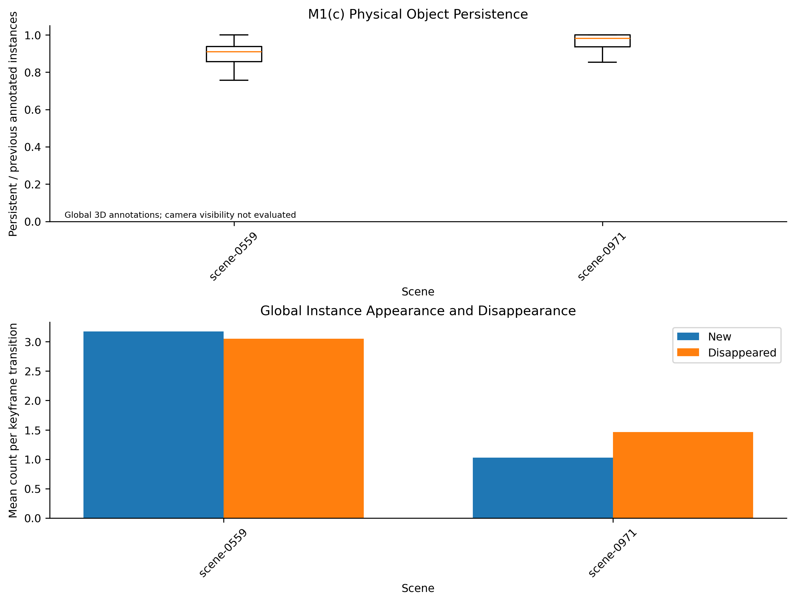
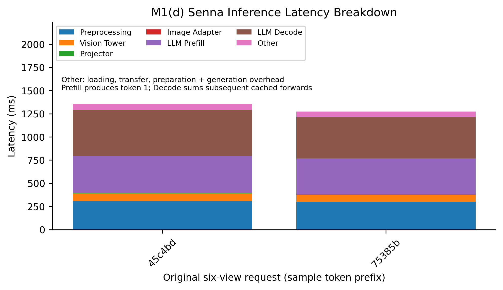
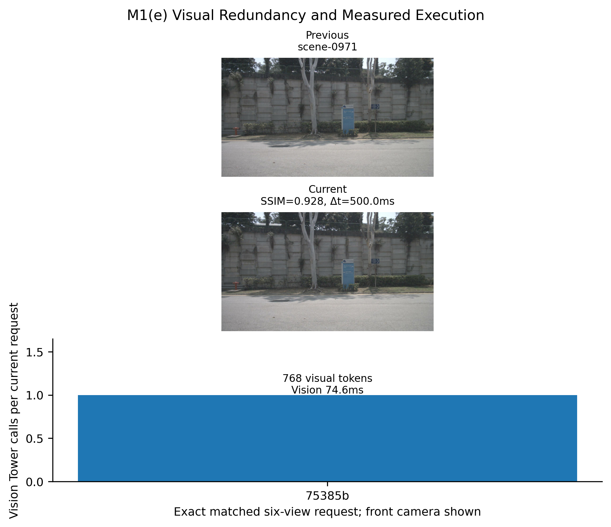
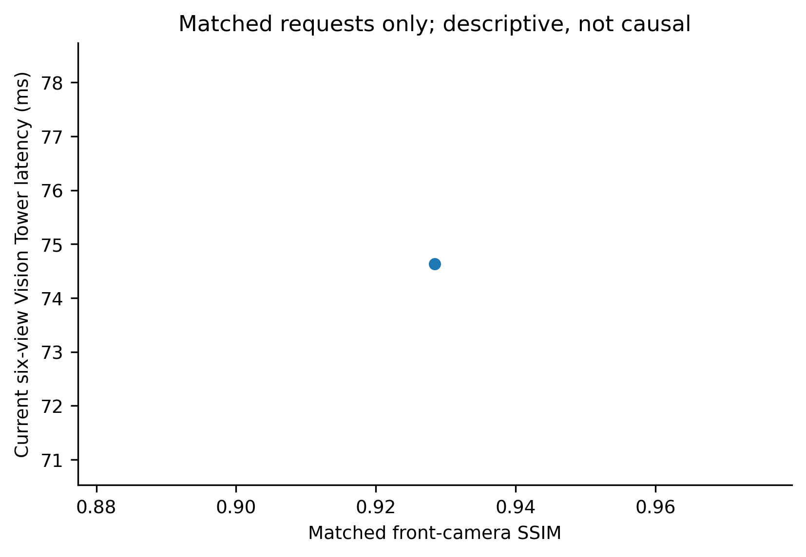

# WorldStream Motivation Experiment 1

## Hypothesis and scope

Continuous driving observations may contain persistent visual content while the original request-based VLM repeats visual encoding. This experiment measures existing behavior only; it implements no WorldStream mechanism. Similarity, persistence and cost are measured independently except for explicitly verified matched records.

## Reproduction and provenance

- Senna commit: `unavailable; source SHA256 recorded`; local source SHA256 hashes and working-tree changes are recorded in `run_metadata.json`.
- Checkpoint: `/data/qh/phdCode/work4/models/Senna`; original base weights, no LoRA or weight changes.
- nuScenes: `v1.0-trainval` at `/data/dataset/v1.0-trainval`.
- Evaluation JSON: `/data/qh/phdCode/work4/Senna/data/senna_nusc_val_plan_corrected.json`; SHA256 `5d974da8bffd6bd2668efb9fd92ea4b7c7f906a429016597dfd4ddc51b176c5b`.
- Seed: 42; resolved settings in `resolved_config.yaml`.
- Python: `3.10.22 (main, Oct 29 2026, 20:33:25) [GCC 14.3.0]`.
- Camera order: `CAM_FRONT, CAM_FRONT_LEFT, CAM_FRONT_RIGHT, CAM_BACK_LEFT, CAM_BACK_RIGHT, CAM_BACK`.
- Local fork contains corrected camera ordering/navigation and validated evaluation inputs. The experiment invokes this local `eval_multi_img_model_wo_init` directly. Official reference: https://github.com/hustvl/Senna.

## Workload and indexing

`sample_data.next` is followed separately for all six cameras, including non-keyframe sweeps. Scene boundaries, calibrated sensor channels, cycles, file existence, reciprocal links and timestamp anomalies are checked. The 0.083s target uses direct adjacent camera links within the configured tolerance; the 0.5s target uses successive keyframes only. Other targets use nearest later timestamps within tolerance. Actual camera timestamps are always retained. Pairs are selected with seeded content-independent hashes, round-robin over Scene/Camera/gap strata.

| Quantity | Recorded count |
|---|---:|
| indexed_scenes | 2 |
| indexed_images | 2786 |
| present_images | 2786 |
| non_key_frames | 2300 |
| selected_pairs | 36 |
| valid_pairs | 36 |
| failed_pairs | 0 |
| global_annotation_pairs | 79 |
| profile_samples | 2 |
| profile_repeats | 2 |
| matched_front_pairs | 1 |

## Image-space similarity

Analysis-only resize: `[320, 192]` pixels; patch grid: `[8, 8]`. SSIM uses RGB channel averaging, Gaussian local moments (11×11, sigma 1.5, population covariance) and valid interior pixels. Small patches use a documented smaller odd window. PSNR uses peak=1 after division by 255; identical images have +infinity PSNR. Infinite values are excluded from finite PSNR quantiles, with identical-pixel cases retained in raw CSV. Normalized pixel difference is mean absolute RGB difference in [0,1].

Unweighted mean of within-scene means; 95% percentile bootstrap over scene means. CI undefined with <2 scenes. Latency percentiles describe recorded requests/repeats, not independent scene samples.

| Camera | Gap | Pairs | Scenes | Actual Δt ms (scene mean) | SSIM scene mean | Scene bootstrap 95% CI |
|---|---|---:|---:|---:|---:|---|
| CAM_BACK | 0.25s | 2 | 2 | 250 | 0.5796 | [0.5174, 0.6418] |
| CAM_BACK | 0.5s | 2 | 2 | 500 | 0.5102 | [0.4188, 0.6016] |
| CAM_BACK | adjacent | 2 | 2 | 75 | 0.7677 | [0.6945, 0.8408] |
| CAM_BACK_LEFT | 0.25s | 2 | 2 | 250 | 0.3323 | [0.2703, 0.3943] |
| CAM_BACK_LEFT | 0.5s | 2 | 2 | 500 | 0.7173 | [0.4547, 0.9799] |
| CAM_BACK_LEFT | adjacent | 2 | 2 | 50 | 0.4443 | [0.3683, 0.5203] |
| CAM_BACK_RIGHT | 0.25s | 2 | 2 | 250 | 0.7433 | [0.4977, 0.989] |
| CAM_BACK_RIGHT | 0.5s | 2 | 2 | 500 | 0.3817 | [0.3351, 0.4283] |
| CAM_BACK_RIGHT | adjacent | 2 | 2 | 100 | 0.5356 | [0.4947, 0.5766] |
| CAM_FRONT | 0.25s | 2 | 2 | 250 | 0.7774 | [0.6017, 0.9531] |
| CAM_FRONT | 0.5s | 2 | 2 | 500 | 0.3684 | [0.2894, 0.4475] |
| CAM_FRONT | adjacent | 2 | 2 | 75.35 | 0.6063 | [0.4974, 0.7152] |
| CAM_FRONT_LEFT | 0.25s | 2 | 2 | 250 | 0.3727 | [0.3245, 0.421] |
| CAM_FRONT_LEFT | 0.5s | 2 | 2 | 500 | 0.3472 | [0.3169, 0.3774] |
| CAM_FRONT_LEFT | adjacent | 2 | 2 | 75 | 0.4638 | [0.4197, 0.508] |
| CAM_FRONT_RIGHT | 0.25s | 2 | 2 | 250 | 0.4376 | [0.365, 0.5102] |
| CAM_FRONT_RIGHT | 0.5s | 2 | 2 | 500 | 0.2477 | [0.2251, 0.2703] |
| CAM_FRONT_RIGHT | adjacent | 2 | 2 | 74.93 | 0.65 | [0.5026, 0.7973] |

All PSNR, normalized difference and patch threshold statistics, including confidence intervals, are in `scene_statistics.csv` and `aggregate_summary.json`. Thresholds are sensitivity analyses; high patch similarity is not object identity or a FLOPs-saving fraction.

## Annotated physical instance persistence

Scope: global official 3D annotations at adjacent keyframes. Persistence ratio = size(intersection of instance tokens) / previous instance count; an empty previous set is undefined. Jaccard is also recorded. These are neither per-camera visibility estimates nor fabricated sweep annotations.

79 annotated keyframe pairs, 2 scenes; scene-equal persistence mean 0.9284, scene bootstrap 95% CI [0.8987, 0.958].

| Global metric | Scene-equal mean | 95% scene-bootstrap CI |
|---|---:|---|
| instance_jaccard | 0.8701 | [0.8096, 0.9305] |
| new_instance_count | 2.1 | [1.026, 3.175] |
| disappeared_instance_count | 2.256 | [1.462, 3.05] |

## High visual similarity with global identity-set changes

High per-camera image SSIM co-occurring with a GLOBAL annotated instance-set change. This does not establish that a changed object is visible in that camera. Motion of persistent identities is not measured; unchanged identity sets do not imply unchanged object states.

This joins the same scene and the exact pair of annotated keyframe sample tokens. Camera exposure times and annotation timestamps are recorded separately. Sweep sample_token fields alone are not accepted as keyframe evidence.

| Camera | SSIM ≥ | Matched transitions | With global identity-set changes | Scene-equal changed fraction | Scene-bootstrap 95% CI |
|---|---:|---:|---:|---:|---|
| CAM_BACK | 0.70 | 0 | 0 | unavailable | undefined (<2 scenes) |
| CAM_BACK | 0.80 | 0 | 0 | unavailable | undefined (<2 scenes) |
| CAM_BACK | 0.90 | 0 | 0 | unavailable | undefined (<2 scenes) |
| CAM_BACK_LEFT | 0.70 | 1 | 1 | 1 | undefined (<2 scenes) |
| CAM_BACK_LEFT | 0.80 | 1 | 1 | 1 | undefined (<2 scenes) |
| CAM_BACK_LEFT | 0.90 | 1 | 1 | 1 | undefined (<2 scenes) |
| CAM_BACK_RIGHT | 0.70 | 0 | 0 | unavailable | undefined (<2 scenes) |
| CAM_BACK_RIGHT | 0.80 | 0 | 0 | unavailable | undefined (<2 scenes) |
| CAM_BACK_RIGHT | 0.90 | 0 | 0 | unavailable | undefined (<2 scenes) |
| CAM_FRONT | 0.70 | 0 | 0 | unavailable | undefined (<2 scenes) |
| CAM_FRONT | 0.80 | 0 | 0 | unavailable | undefined (<2 scenes) |
| CAM_FRONT | 0.90 | 0 | 0 | unavailable | undefined (<2 scenes) |
| CAM_FRONT_LEFT | 0.70 | 0 | 0 | unavailable | undefined (<2 scenes) |
| CAM_FRONT_LEFT | 0.80 | 0 | 0 | unavailable | undefined (<2 scenes) |
| CAM_FRONT_LEFT | 0.90 | 0 | 0 | unavailable | undefined (<2 scenes) |
| CAM_FRONT_RIGHT | 0.70 | 0 | 0 | unavailable | undefined (<2 scenes) |
| CAM_FRONT_RIGHT | 0.80 | 0 | 0 | unavailable | undefined (<2 scenes) |
| CAM_FRONT_RIGHT | 0.90 | 0 | 0 | unavailable | undefined (<2 scenes) |

## Original Senna architecture and runtime

Actual entry: `llava/model/builder.py::load_senna_pretrained_model` → `SennaLlavaLlamaForCausalLM`, with the implementation in `llava/senna/`, rather than generic `llava/model/llava_arch.py`. CLIP ViT-L/14-336 selects layer -2 patch features (576 tokens per image). Each of six views passes through the MLP Projector and the original img_adapter (128 tokens per image, 768 total). These are confirmed at runtime by recorded module shapes rather than assumed in the statistics.

Read-only module hooks surround `get_vision_tower()`, `get_model().mm_projector` and `get_model().img_adapter`. Temporary transparent wrappers time loading/preprocessing, bracket multimodal preparation and `generate()`, and measure the original LLM `forward()` calls without modifying their arguments or outputs. All attributes/hooks are restored even on exceptions. LLM KV cache remains within each generation request; no visual state crosses requests.

Single-device stage durations use CUDA events on the current stream. They include stream idle/CPU-dispatch gaps between events, and are not pure kernel-only costs. Preparation and generation are parent intervals: exclusive preparation = preparation − Vision − Projector − adapter; LLM generation = generation − inclusive preparation before the LLM. The no-op preparation checks inside cached forwards remain in Decode to avoid overlap. End-to-end uses synchronized wall clock and includes loading, preprocessing, transfer, prompt processing and answer decoding. Other is its residual. Prefill is the actual full-prompt forward with empty incoming KV cache; Decode sums subsequent single-token forwards with nonempty KV cache. CUDA events bracket the original forwards. Prefill produces logits for generated token 1, so Decode has output_tokens − 1 calls. Generation setup, token selection, cache bookkeeping, stopping checks and dispatch outside forward are retained as llm_generation_overhead_ms. The measured Prefill + Decode + generation overhead equals the exclusive LLM generation parent. Prefill is not end-to-end time to first token, and these are stream intervals rather than pure kernel times. Multiple-device models get synchronized wall time and metadata, with unreliable stage decomposition left unavailable. Detailed Profiler records are excluded from latency summaries.

Model load: 1.921e+04 ms (excluded from steady-state results). GPU: `NVIDIA GeForce RTX 3090`. Warmup iterations: 1; repeats per request: 1; max new tokens: 64; temperature=0, beam=1, template=llava_v1, use_cache=True.

Output equivalence: 2/2 fixed samples passed exact token IDs, decoded answers, prediction plans, input tensor hashes and generation configuration checks.

| Stage/metric | Finite records | Mean | P50 | P95 | P99 |
|---|---:|---:|---:|---:|---:|
| image_file_loading_ms | 2 | 44.07 | 44.07 | 48.14 | 48.51 |
| image_preprocessing_ms | 2 | 305.1 | 305.1 | 308.7 | 309 |
| host_to_device_ms | 2 | 2.452 | 2.452 | 2.662 | 2.681 |
| vision_tower_ms | 2 | 78.37 | 78.37 | 81.74 | 82.04 |
| projector_ms | 2 | 3.076 | 3.076 | 3.44 | 3.472 |
| img_adapter_ms | 2 | 0.2638 | 0.2638 | 0.2699 | 0.2704 |
| multimodal_preparation_ms | 2 | 2.288 | 2.288 | 2.435 | 2.448 |
| llm_generation_ms | 2 | 875 | 875 | 900.5 | 902.8 |
| llm_prefill_ms | 2 | 393.6 | 393.6 | 397.7 | 398.1 |
| llm_decode_ms | 2 | 473.9 | 473.9 | 496.1 | 498.1 |
| llm_generation_overhead_ms | 2 | 7.42 | 7.42 | 8.169 | 8.236 |
| llm_decode_ms_per_token | 2 | 63.25 | 63.25 | 64.09 | 64.16 |
| other_ms | 2 | 3.899 | 3.899 | 4.087 | 4.104 |
| end_to_end_ms | 2 | 1314 | 1314 | 1351 | 1354 |
| vision_latency_ratio | 2 | 0.05959 | 0.05959 | 0.06049 | 0.06056 |
| projector_latency_ratio | 2 | 0.002333 | 0.002333 | 0.002544 | 0.002563 |
| visual_path_latency_ratio | 2 | 0.06212 | 0.06212 | 0.06323 | 0.06333 |
| llm_generation_latency_ratio | 2 | 0.6656 | 0.6656 | 0.6664 | 0.6665 |
| llm_prefill_latency_ratio | 2 | 0.2996 | 0.2996 | 0.3049 | 0.3054 |
| llm_decode_latency_ratio | 2 | 0.3603 | 0.3603 | 0.3671 | 0.3677 |
| llm_generation_overhead_latency_ratio | 2 | 0.00567 | 0.00567 | 0.006398 | 0.006463 |
| ideal_visual_path_speedup_bound | 2 | 1.066 | 1.066 | 1.067 | 1.068 |

`profile_scene_statistics` in `aggregate_summary.json` records scene-level latency confidence intervals. Request output lengths exclude the artificial initial BOS token in the inspected inputs_embeds generation path; returned sequence length and BOS removal are also recorded. Shapes, allocated/reserved GPU peaks, call counts and per-forward CUDA durations/input lengths/incoming and outgoing KV lengths are in `profiling_samples.csv`. Exactly one Prefill, one-token cached Decode, monotonic KV growth and the forward/output-token count relationship are checked per request. `llm_decode_ms_per_token` divides Decode by the cached-forward count, excluding generated token 1. Detailed traces expose `senna.llm_prefill` and `senna.llm_decode` ranges; these ranges are disabled in low-overhead timing. The ideal bound removes measured Vision + Projector + adapter time at zero added management cost; it is not a measured or attainable speedup.

Recorded input_shape: `[1, 6, 3, 336, 336]`.

Recorded vision_tokens_per_image: `576`.

Recorded visual_tokens_total: `768`.

Recorded output_tokens: `8, 9`.

Peak allocated memory on cuda:0: 14.333 GiB (includes resident weights; per-request peaks in CSV).

## Figures and matched workload

Similarity and original inference use distinct input sources. Sample-level comparisons use only `matched_profile_pairs.csv`, which verifies sample tokens and all six exact image paths against the keyframe manifest. Front-camera similarity is an explanatory covariate of the same six-view request, not a camera-specific latency measurement. No correlation is inferred from unrelated averages.

[Vector PDF](figures/M1a_temporal_similarity.pdf). Availability: True. 

[Vector PDF](figures/M1b_patch_similarity.pdf). Availability: True. 

[Vector PDF](figures/M1c_object_persistence.pdf). Availability: True. 

[Vector PDF](figures/M1d_latency_breakdown.pdf). Availability: True. 

[Vector PDF](figures/M1e_repeated_execution.pdf). Availability: True. Exact six-camera sample_data linkage required

[Vector PDF](figures/matched_similarity_latency.pdf). Availability: True. 

M1(d) replaces the former LLM Generation bar with measured LLM Prefill and LLM Decode. Image Adapter is displayed separately. Other includes loading, transfer, exclusive preparation, generation overhead and residual costs. Its stacked segments still sum to synchronized end-to-end latency. Up to the first 12 requests are shown, averaging the recorded repeats per request; full-workload statistics use all timing records. Parent timings are never stacked with their children. M1(e) has no fabricated values when exact linkage is absent.

## Missing data, anomalies and limitations

- index: complete; 
- objects: complete; 
- profile: complete; 
- redundancy: complete; 
- manifest_issues: 1 recorded issues; inspect `manifest_issues.json`.
- similarity_issues: 0 recorded issues; inspect `similarity_issues.json`.
- object_issues: 0 recorded issues; inspect `object_issues.json`.
- matched_profile_issues: 0 recorded issues; inspect `matched_profile_issues.json`.
- CPU OS page cache is not flushed; file-loading cost reflects the warm workload. Instrumentation has small overhead; detailed tracing is kept separate.
- Scene bootstrap with few scenes is exploratory; a smoke test establishes executability, not a representative workload claim. No hypothesis significance or practical-cost threshold is predeclared.
- Camera exposure timestamps are asynchronous. Temporal similarity is camera-specific; global annotations use sample timestamps.
- Scene selection prefers the configured evaluation workload when scene tokens are available. Results describe that sampled population.

## Observation Supported by Evidence

Measured group-level scene-mean SSIM spans 0.2477–0.7774; the tables and M1(a/b) quantify content similarity and its variation with actual interval and camera. The measurements, rather than a preset redundancy assumption, determine the observation.

Global annotated instances persist at the recorded ratio of 0.9284; camera-visible persistence remains unmeasured.

All 2 recorded low-overhead requests execute 1–1 Vision Tower calls; runtime shapes/call counts establish repeated encoding for these requests. Vision latency fraction mean is 0.05959; its practical importance must be judged against the measured end-to-end cost and workload variability.

For each recorded input shape, `input_shape_groups` reports encoding token counts and latency. Fixed token counts establish a fixed encoding scale in the tested inputs; they do not establish that runtime cost is independent of scene content. The hypothesis receives evidence only for the recorded components and sampled workload.

## Claims Not Established

- Image similarity does not establish direct reuse of visual features.
- Persistent annotated objects do not establish that all visual encoding is redundant.
- World Alignment benefits have not been demonstrated.
- Incremental inference GPU speedups have not been demonstrated.
- Deadline misses have not been demonstrated.
- No new WorldStream mechanism has been evaluated.
- Statistical association is not causation, and separate dataset averages do not establish per-request correlation.
