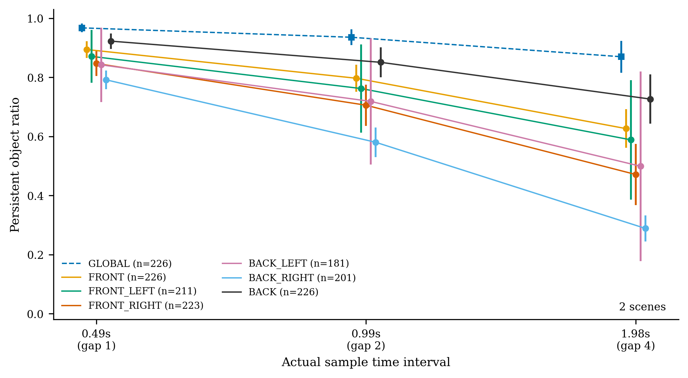
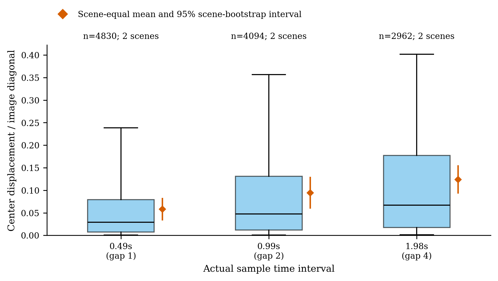
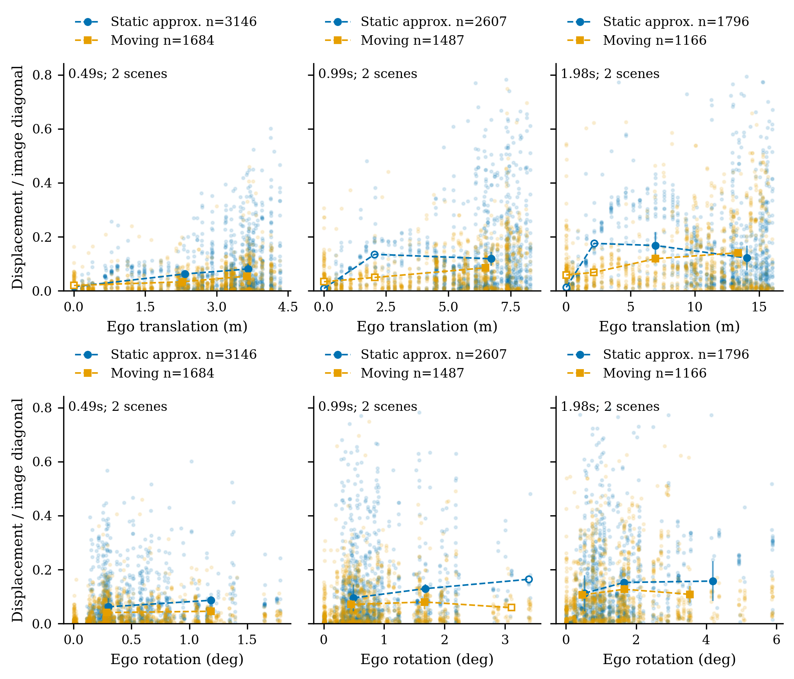
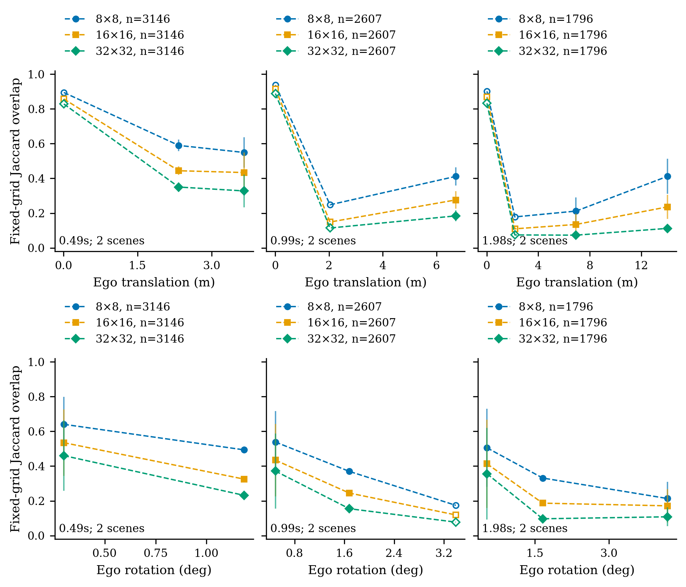
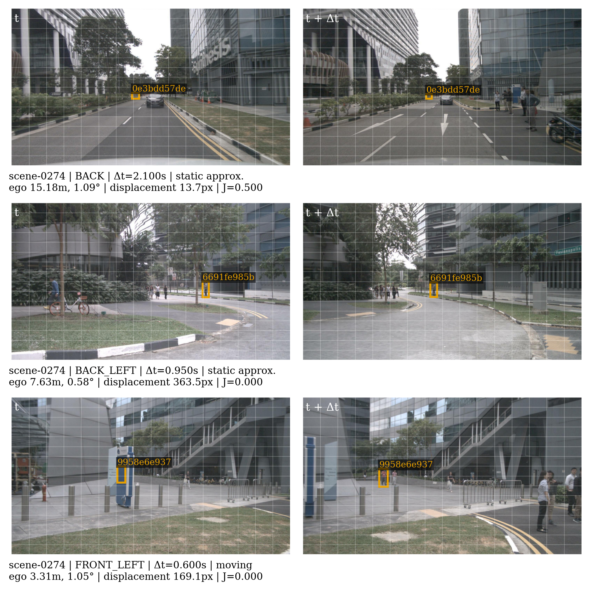
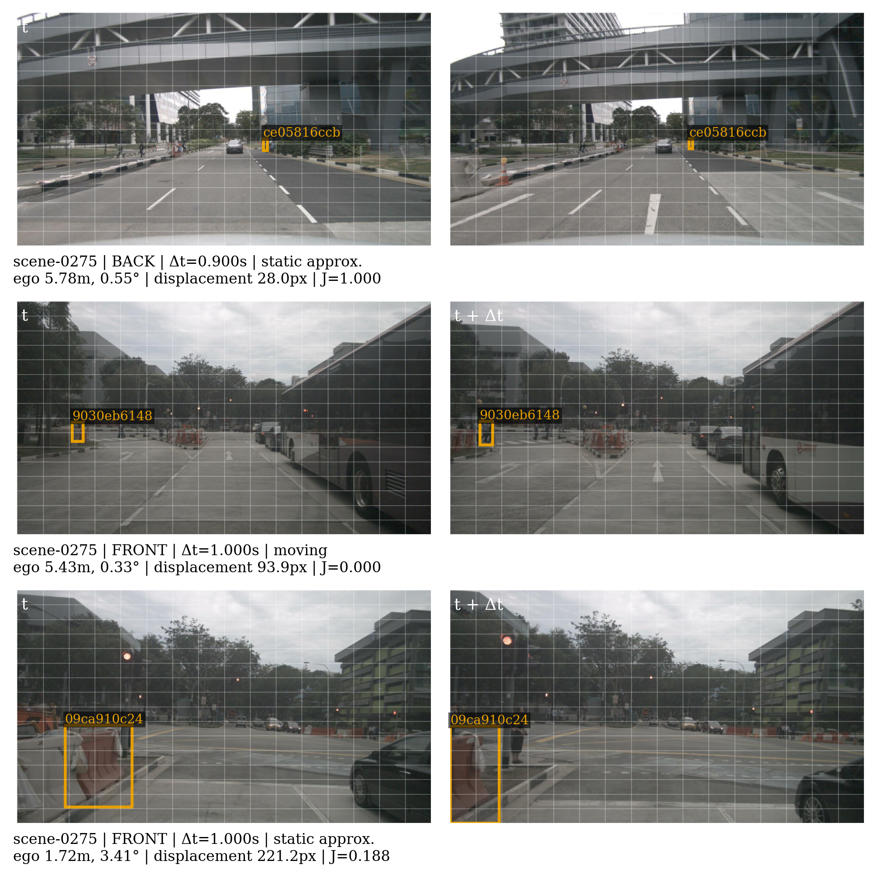

# Experiment 2: Physical Continuity vs. Image-Space Displacement

## Goal and hypotheses

Measure whether official annotated physical instances persist across driving keyframes, and whether their camera bounding rectangles remain at fixed image locations. All evidence below is from configured real nuScenes data; no VLM, GPU, training, feature reuse, state alignment, or scheduling is executed.

H1: annotated instance identity often persists. H2: persistent instances can move in image coordinates and fixed grids. H3: observed ego-motion and image migration are statistically associated. Effect sizes and scene-level intervals are reported; no universal significance threshold or ego-only causal claim is assumed.

## Dataset and indexing

- nuScenes version: `v1.0-trainval`.
- Scenes: 2; annotated keyframes: 80; keyframe pairs: 226; camera frames: 480.
- Reused and verified E1 camera-manifest keyframe rows: 480.
- All configured sample.next gaps are retained within each scene; no sweeps or cross-scene pairs are used. Sample and per-camera timestamp gaps are separate.
- Gaps: [1, 2, 4]; cameras: ['CAM_FRONT', 'CAM_FRONT_LEFT', 'CAM_FRONT_RIGHT', 'CAM_BACK_LEFT', 'CAM_BACK_RIGHT', 'CAM_BACK'].

| Scene | Token | Description |
| --- | --- | --- |
| scene-0274 | 9709626638f5406f9f773348150d02fd | Peds, construction zone, construction workers, barriers, cars, jaywalker |
| scene-0275 | 8377abf77f464a9cb62eacf63f383422 | Peds, bus, barriers, stopped at intersection |

## Geometry and annotation timing

Official `get_sample_data(..., BoxVisibility.NONE)` provides all camera-frame boxes; each Box token is checked against the sample's annotation tokens. Identity is the annotation's `instance_token`, with category resolved via the official devkit instance/category records.

Column-vector convention: ego poses map Ego→Global, calibrated sensor transforms map Camera→Ego. World→Camera equals inverse(Camera→Ego) × inverse(Ego→Global). Actual camera exposure ego poses and intrinsics are used. Pixel origin is top left. Official `view_points` projects the 3D corners; the image-clipped 2D rectangle supplies the center and grid region.

Sample-level keyframe boxes are used without interpolation at camera exposure time, following the official keyframe API. This is a time-alignment assumption, not sweep-time ground truth. Signed offset = (camera timestamp − sample timestamp).

- Camera/annotation offsets: min -46.816 ms, median -25.410 ms, max 0.031 ms.
- Near plane: 0.1 m. Crossings are explicitly excluded, not approximately clipped.
- Minimum image-clipped box size: 8 × 8 pixels; geometric rectangle area ratio ≥ 0.2.
- Projected-in-view objects are not guaranteed to be unoccluded or fully visible. The geometric area ratio is clipped/raw bounding-rectangle area, not exact object visibility.
- Numerical independent-transform comparisons and real official-wireframe overlays are saved in `metadata/projection_regression.json` and `visualizations/projection_regression_*.png`.

## Counts and exclusions

| Quantity | Count |
| --- | --- |
| keyframe_pairs | 226 |
| projection_attempts | 30126 |
| valid_projections | 5638 |
| global_persistent_pair_instances | 13001 |
| matched_camera_pair_instances | 11886 |
| unique_matched_physical_instances | 294 |
| matched_scenes | 2 |
| grid_diagnostic_rows | 106974 |

Global persistent pair-instance counts repeat instances over time; matched camera-pair counts can also repeat a physical instance across cameras. Neither count is an independent sample size.

| Projection status | Count | Fraction of attempts |
| --- | --- | --- |
| behind_or_inside_near_plane | 14826 | 0.4921 |
| outside_image | 8456 | 0.2807 |
| valid | 5638 | 0.1871 |
| near_plane_crossing_excluded | 911 | 0.0302 |
| low_in_image_area_ratio | 213 | 0.0071 |
| too_small | 82 | 0.0027 |

Geometrically clipped attempts: 9477. Valid fraction: 0.1871. The denominator includes all annotated instances in each camera, including objects behind that camera; this fraction is not a detector recall.

Index anomalies/missing data: 0. Full issue records: `metadata/index_summary.json` and `metadata/displacement_summary.json`.
Zero initial instance sets produce NaN, not 0%; empty grid unions produce NaN, and empty old-grid sets have undefined retention.

## Statistical units and uncertainty

All mean CIs resample scene means (1000 draws, seed 42); one-scene CIs are unavailable. Instance-observation weighted means and scene-equal means are separate. Persistence additionally reports the pooled instance-weighted count ratio. Distribution quantiles pool observations and are descriptive. Cross-camera projections and repeated frames are never used as independent bootstrap units.

Spearman correlations on individual observations are descriptive, with no IID p-values. Scene-level correlation compares scene medians, and its interval bootstraps scenes. Time gap, camera direction, object distance and approximate object motion strata are retained in `statistics/summary.json`.

## Physical persistence

This is a small-scene functional workload. With at most two scene clusters, bootstrap intervals are smoke-test diagnostics and do not support publication-level precision or representative-driving conclusions.

| Gap | Set | Valid pairs | Pooled instance ratio | Scene mean | Scene CI95 |
| --- | --- | --- | --- | --- | --- |
| 1 | GLOBAL | 78 | 0.9621 | 0.9673 | [0.952760205781343, 0.981796636267307] |
| 2 | GLOBAL | 76 | 0.9253 | 0.9355 | [0.9085212753876974, 0.9623926530049127] |
| 4 | GLOBAL | 72 | 0.8499 | 0.8696 | [0.8157599153872513, 0.9234767165361139] |
| 1 | CAM_BACK | 78 | 0.9038 | 0.9224 | [0.8961999037189898, 0.9485225286695874] |
| 1 | CAM_BACK_LEFT | 63 | 0.9287 | 0.8420 | [0.7163968253968254, 0.967658855584756] |
| 1 | CAM_BACK_RIGHT | 69 | 0.7643 | 0.7914 | [0.7600243140032634, 0.8227380952380953] |
| 1 | CAM_FRONT | 78 | 0.8827 | 0.8940 | [0.8658554370745382, 0.9220679601661238] |
| 1 | CAM_FRONT_LEFT | 73 | 0.9205 | 0.8707 | [0.7810574229691877, 0.9603906010084499] |
| 1 | CAM_FRONT_RIGHT | 77 | 0.8123 | 0.8466 | [0.8044867749298928, 0.8887426900584796] |
| 2 | CAM_BACK | 76 | 0.8130 | 0.8507 | [0.8000205045082934, 0.9014129167186443] |
| 2 | CAM_BACK_LEFT | 61 | 0.8733 | 0.7183 | [0.504872557997558, 0.9316967980125875] |
| 2 | CAM_BACK_RIGHT | 67 | 0.5281 | 0.5800 | [0.5297149379613372, 0.6302134646962233] |
| 2 | CAM_FRONT | 76 | 0.7725 | 0.7967 | [0.7512449626026075, 0.84215147771508] |
| 2 | CAM_FRONT_LEFT | 71 | 0.8441 | 0.7619 | [0.6127178377178377, 0.911041640534347] |
| 2 | CAM_FRONT_RIGHT | 75 | 0.6412 | 0.7055 | [0.6356073603941933, 0.7753003003003003] |
| 4 | CAM_BACK | 72 | 0.6559 | 0.7263 | [0.6431659369254135, 0.8094619614227457] |
| 4 | CAM_BACK_LEFT | 57 | 0.7950 | 0.4989 | [0.17795815295815295, 0.8199044620097251] |
| 4 | CAM_BACK_RIGHT | 65 | 0.2244 | 0.2885 | [0.244167168615698, 0.33275862068965517] |
| 4 | CAM_FRONT | 72 | 0.5828 | 0.6263 | [0.5609254800028417, 0.6916364942160423] |
| 4 | CAM_FRONT_LEFT | 67 | 0.7255 | 0.5883 | [0.3862371499468274, 0.790402496937323] |
| 4 | CAM_FRONT_RIGHT | 71 | 0.3772 | 0.4710 | [0.3677474409712654, 0.5742063492063492] |

## Image displacement

| Gap | Camera-pair instances | Median px | Pooled norm mean | Norm median | P75 | P90 | P95 | Scene norm mean | CI95 | Median bbox IoU |
| --- | --- | --- | --- | --- | --- | --- | --- | --- | --- | --- |
| 1 | 4830 | 53.8 | 0.0601 | 0.0293 | 0.0794 | 0.1550 | 0.2390 | 0.0582 | [0.03307155689052307, 0.0832640496639103] | 0.0732 |
| 2 | 4094 | 86.9 | 0.0950 | 0.0473 | 0.1311 | 0.2426 | 0.3569 | 0.0946 | [0.059317298916394, 0.1298410687622081] | 0.0000 |
| 4 | 2962 | 122.6 | 0.1202 | 0.0668 | 0.1774 | 0.3177 | 0.4046 | 0.1241 | [0.09276154818654683, 0.15534201484496274] | 0.0000 |

Image displacement is Euclidean clipped-rectangle center displacement divided by the actual image diagonal. IoU compares two rectangles at the same camera pixel coordinates across time; it is neither matching accuracy nor 3D overlap. Scale ratio is area(t1)/area(t0). Boundary clipping can affect these measurements.

## Ego-motion and object-motion strata

Relative ego transform = inverse(T_global_ego0) × T_global_ego1. Translation magnitude is global Euclidean distance; components are in the initial ego frame. Rotation uses the shortest normalized-quaternion angle; signed yaw differences wrap to [−π, π]. Speed/yaw rate use actual camera gaps. Object speed uses global annotation-center distance divided by the actual sample gap.

Approximately static threshold: ≤ 0.5 m/s. This subset excludes much unannotated background (roads, buildings) and can include annotation noise or slowly moving objects.

| Gap | Object motion | n | Median normalized displacement | Scene mean | CI95 |
| --- | --- | --- | --- | --- | --- |
| 1 | approximately_static | 3146 | 0.0365 | 0.0655 | [0.03645473391327946, 0.09461152771255815] |
| 1 | moving | 1684 | 0.0232 | 0.0417 | [0.02843455068361415, 0.054948664841848086] |
| 2 | approximately_static | 2607 | 0.0546 | 0.1043 | [0.06375970033976744, 0.14493980350623106] |
| 2 | moving | 1487 | 0.0418 | 0.0742 | [0.05329939466263812, 0.09511638694262108] |
| 4 | approximately_static | 1796 | 0.0674 | 0.1298 | [0.09527148123009721, 0.1642462471596689] |
| 4 | moving | 1166 | 0.0665 | 0.1140 | [0.08943018251056178, 0.1386194322051487] |

| Gap | Object motion | Variable | n | Observation ρ | Scene-median ρ | Scene CI95 |
| --- | --- | --- | --- | --- | --- | --- |
| 1 | approximately_static | ego_translation_m | 3146 | 0.4515 | NaN / unavailable | None |
| 1 | approximately_static | ego_rotation_deg | 3146 | 0.4132 | NaN / unavailable | None |
| 1 | approximately_static | ego_yaw_change_deg | 3146 | -0.0052 | NaN / unavailable | None |
| 1 | moving | ego_translation_m | 1684 | 0.3631 | NaN / unavailable | None |
| 1 | moving | ego_rotation_deg | 1684 | 0.1734 | NaN / unavailable | None |
| 1 | moving | ego_yaw_change_deg | 1684 | -0.0596 | NaN / unavailable | None |
| 2 | approximately_static | ego_translation_m | 2607 | 0.4436 | NaN / unavailable | None |
| 2 | approximately_static | ego_rotation_deg | 2607 | 0.4593 | NaN / unavailable | None |
| 2 | approximately_static | ego_yaw_change_deg | 2607 | -0.0508 | NaN / unavailable | None |
| 2 | moving | ego_translation_m | 1487 | 0.3198 | NaN / unavailable | None |
| 2 | moving | ego_rotation_deg | 1487 | 0.1829 | NaN / unavailable | None |
| 2 | moving | ego_yaw_change_deg | 1487 | -0.0807 | NaN / unavailable | None |
| 4 | approximately_static | ego_translation_m | 1796 | 0.4455 | NaN / unavailable | None |
| 4 | approximately_static | ego_rotation_deg | 1796 | 0.5349 | NaN / unavailable | None |
| 4 | approximately_static | ego_yaw_change_deg | 1796 | -0.0078 | NaN / unavailable | None |
| 4 | moving | ego_translation_m | 1166 | 0.2224 | NaN / unavailable | None |
| 4 | moving | ego_rotation_deg | 1166 | 0.1828 | NaN / unavailable | None |
| 4 | moving | ego_yaw_change_deg | 1166 | -0.0181 | NaN / unavailable | None |

Distance changes, object motion, camera direction, clipping, occlusion and 3D annotation error are possible contributors. These correlations do not isolate ego-motion as the cause. A stricter ego-only causal decomposition remains future analysis.

## Fixed image grid diagnostics

Main cell rule: `any`; sensitivity rules: ['any', 'coverage', 'center']; coverage rule minimum cell area ratio: 0.25.
J = |G0∩G1|/|G0∪G1|; R = |G0∩G1|/|G0|. Rules use positive-area intersection, a minimum intersection/cell-area fraction, or cell-center inclusion. Boundary-only contact is excluded. Grid displacement measures center shift in cell-width/height units. These diagnostic grids are not Senna/CLIP token grids or cache hit rates.

| Gap | Grid | Rule | Valid J n | Scene J mean | J CI95 | Scene old-cell retention |
| --- | --- | --- | --- | --- | --- | --- |
| 1 | 8×8 | any | 4830 | 0.6324 | [0.5064405314481806, 0.7583465260147025] | 0.7169 |
| 1 | 8×8 | center | 2401 | 0.2877 | [0.12156871643597308, 0.453894435263229] | 0.3829 |
| 1 | 8×8 | coverage | 2190 | 0.3893 | [0.19577490020910618, 0.5827785202373471] | 0.4765 |
| 1 | 16×16 | any | 4830 | 0.5051 | [0.35219240827096393, 0.6579695051801719] | 0.5971 |
| 1 | 16×16 | center | 3508 | 0.2786 | [0.1157201883517194, 0.44155902202663205] | 0.3621 |
| 1 | 16×16 | coverage | 3759 | 0.3593 | [0.1791389623362292, 0.5395271873060259] | 0.4326 |
| 1 | 32×32 | any | 4830 | 0.4205 | [0.26261423082960295, 0.57829745838934] | 0.5062 |
| 1 | 32×32 | center | 4425 | 0.2902 | [0.13423060635221343, 0.44622491536164033] | 0.3609 |
| 1 | 32×32 | coverage | 4606 | 0.3421 | [0.17596983327944185, 0.5082093202655649] | 0.4110 |
| 2 | 8×8 | any | 4094 | 0.4980 | [0.3720687174058049, 0.6239100136434425] | 0.5742 |
| 2 | 8×8 | center | 2101 | 0.2088 | [0.08846596237900585, 0.3290453029344225] | 0.3009 |
| 2 | 8×8 | coverage | 1881 | 0.3046 | [0.16417073448973588, 0.445072866317093] | 0.3914 |
| 2 | 16×16 | any | 4094 | 0.3814 | [0.24663042607541655, 0.5162063029540177] | 0.4579 |
| 2 | 16×16 | center | 2918 | 0.2125 | [0.09101666699271155, 0.33404388769499493] | 0.2804 |
| 2 | 16×16 | coverage | 3193 | 0.2617 | [0.11128947348269345, 0.41219177735915014] | 0.3207 |
| 2 | 32×32 | any | 4094 | 0.3071 | [0.17820247942931358, 0.4360497586604397] | 0.3723 |
| 2 | 32×32 | center | 3753 | 0.2132 | [0.08941603755757377, 0.33705812578053695] | 0.2702 |
| 2 | 32×32 | coverage | 3916 | 0.2457 | [0.11499837115580372, 0.3764121285333908] | 0.2958 |
| 4 | 8×8 | any | 2962 | 0.4162 | [0.3210385274715013, 0.511290384364199] | 0.4860 |
| 4 | 8×8 | center | 1543 | 0.1855 | [0.0933572710951526, 0.27764818571106603] | 0.2800 |
| 4 | 8×8 | coverage | 1436 | 0.2751 | [0.17653133903133902, 0.37362568783627337] | 0.3928 |
| 4 | 16×16 | any | 2962 | 0.3069 | [0.20824518786957918, 0.4055900873997994] | 0.3678 |
| 4 | 16×16 | center | 2123 | 0.1879 | [0.10491065430605938, 0.2709579137469341] | 0.2619 |
| 4 | 16×16 | coverage | 2350 | 0.2201 | [0.11320271267698104, 0.3270090827722968] | 0.2881 |
| 4 | 32×32 | any | 2962 | 0.2395 | [0.14481810357055025, 0.33422625994365124] | 0.2925 |
| 4 | 32×32 | center | 2731 | 0.1816 | [0.08134922818272684, 0.28190736238618624] | 0.2409 |
| 4 | 32×32 | coverage | 2854 | 0.1959 | [0.0902878548843474, 0.3014898877856441] | 0.2445 |

## Sensitivity analyses

| Geometric area ratio threshold | Gap | Valid projections | Matched camera observations | Norm median | Scene norm mean |
| --- | --- | --- | --- | --- | --- |
| 0.0 | 1 | 5851 | 5041 | 0.0298 | 0.0600 |
| 0.0 | 2 | 5851 | 4289 | 0.0479 | 0.0988 |
| 0.0 | 4 | 5851 | 3108 | 0.0671 | 0.1273 |
| 0.2 | 1 | 5638 | 4830 | 0.0293 | 0.0582 |
| 0.2 | 2 | 5638 | 4094 | 0.0473 | 0.0946 |
| 0.2 | 4 | 5638 | 2962 | 0.0668 | 0.1241 |
| 0.5 | 1 | 5357 | 4564 | 0.0277 | 0.0555 |
| 0.5 | 2 | 5357 | 3860 | 0.0447 | 0.0884 |
| 0.5 | 4 | 5357 | 2801 | 0.0632 | 0.1181 |

| Static threshold m/s | Gap | Motion group | n | Norm median | Scene norm mean |
| --- | --- | --- | --- | --- | --- |
| 0.2 | 1 | approximately_static | 2921 | 0.0372 | 0.0662 |
| 0.2 | 1 | moving | 1909 | 0.0230 | 0.0440 |
| 0.2 | 2 | approximately_static | 2440 | 0.0581 | 0.1064 |
| 0.2 | 2 | moving | 1654 | 0.0408 | 0.0741 |
| 0.2 | 4 | approximately_static | 1688 | 0.0687 | 0.1318 |
| 0.2 | 4 | moving | 1274 | 0.0647 | 0.1123 |
| 0.5 | 1 | approximately_static | 3146 | 0.0365 | 0.0655 |
| 0.5 | 1 | moving | 1684 | 0.0232 | 0.0417 |
| 0.5 | 2 | approximately_static | 2607 | 0.0546 | 0.1043 |
| 0.5 | 2 | moving | 1487 | 0.0418 | 0.0742 |
| 0.5 | 4 | approximately_static | 1796 | 0.0674 | 0.1298 |
| 0.5 | 4 | moving | 1166 | 0.0665 | 0.1140 |
| 1.0 | 1 | approximately_static | 3509 | 0.0328 | 0.0636 |
| 1.0 | 1 | moving | 1321 | 0.0226 | 0.0412 |
| 1.0 | 2 | approximately_static | 2911 | 0.0511 | 0.1020 |
| 1.0 | 2 | moving | 1183 | 0.0401 | 0.0737 |
| 1.0 | 4 | approximately_static | 2039 | 0.0697 | 0.1285 |
| 1.0 | 4 | moving | 923 | 0.0593 | 0.1134 |

Grid-rule sensitivity is reported above. Near-plane, minimum-size and bounding-rectangle limitations remain even when the geometric area threshold changes.

## Figures and representative cases



Global annotated persistence and camera projected-in-view persistence use separate sets and different denominators; the curve gap is not a decomposition. Scene-equal pair means; 95% scene-bootstrap intervals; n counts pairs with a nonempty initial set, summed over gaps in each legend. Actual mean sample gaps are shown; camera exposure gaps are recorded separately.



Same official instance ID, same camera and scene, valid projections at both times. Boxes: pooled 25–75%, median; whiskers: 5–95%. Orange diamonds: scene-equal means with 95% scene-bootstrap intervals. n is camera-pair instance observations; repeated temporal pairs, repeated instances and cross-camera projections are dependent.



Time-gap strata; approximately static means global annotation-center speed ≤0.5 m/s over actual sample timestamps. Scatter is seeded and independently capped at 1,200 observations per group, so it does not encode group frequency; binned summaries use all rows. X medians count each unique camera pair once; y is scene-equal displacement mean with 95% scene-bootstrap intervals. Open markers denote one-scene bins without CIs; exact per-bin observation and scene counts are in metadata/figure_bin_counts.json. Dashed segments connect bin summaries, not a fitted causal response. Associations do not establish ego-only causation.



Approximately static annotated objects only: global annotation-center speed ≤0.5 m/s over actual sample timestamps. Main rule any: positive-area box/cell intersection. Grids are diagnostic image regions, not CLIP tokens. X medians count unique camera pairs once; y is scene-equal Jaccard mean with 95% scene-bootstrap intervals. Open markers denote singleton-scene bins without CIs; exact per-bin counts are in metadata/figure_bin_counts.json. Grid variants share the same underlying observations and are not independent objects. Dashed segments connect bin summaries.



The two gold rectangles within each row mark the matched official instance; labels show ten-character token prefixes (full IDs in metadata/CSV). Fixed [16, 16] grid, any overlap. Seeded scene/camera/gap/motion round-robin strata with 5–95% quantile targets include both small and large displacement; cases are illustrative, not statistical evidence. Page 1/2; 6 individual examples saved.



The two gold rectangles within each row mark the matched official instance; labels show ten-character token prefixes (full IDs in metadata/CSV). Fixed [16, 16] grid, any overlap. Seeded scene/camera/gap/motion round-robin strata with 5–95% quantile targets include both small and large displacement; cases are illustrative, not statistical evidence. Page 2/2; 6 individual examples saved.

| Example | Official instance | Motion group | Measurements |
| --- | --- | --- | --- |
| [visualizations/example_00.png](visualizations/example_00.png) | 0e3bdd57de6e447e8105755b094fe09a | approximately_static | scene-0274 | CAM_BACK | Δt=2.100s | ego 15.18m, 1.09° | displacement 13.7px | J=0.500 | approximately_static |
| [visualizations/example_01.png](visualizations/example_01.png) | 6691fe985beb40d0a32510f180c256cb | approximately_static | scene-0274 | CAM_BACK_LEFT | Δt=0.950s | ego 7.63m, 0.58° | displacement 363.5px | J=0.000 | approximately_static |
| [visualizations/example_02.png](visualizations/example_02.png) | 9958e6e9377b41c8ac51fb5b5692c2e1 | moving | scene-0274 | CAM_FRONT_LEFT | Δt=0.600s | ego 3.31m, 1.05° | displacement 169.1px | J=0.000 | moving |
| [visualizations/example_03.png](visualizations/example_03.png) | ce05816ccbf54773b069ddaf20d1b5c7 | approximately_static | scene-0275 | CAM_BACK | Δt=0.900s | ego 5.78m, 0.55° | displacement 28.0px | J=1.000 | approximately_static |
| [visualizations/example_04.png](visualizations/example_04.png) | 9030eb6148f14d71a3e60f4755e633f8 | moving | scene-0275 | CAM_FRONT | Δt=1.000s | ego 5.43m, 0.33° | displacement 93.9px | J=0.000 | moving |
| [visualizations/example_05.png](visualizations/example_05.png) | 09ca910c245a4e70a05a6d4a4c10d5e0 | approximately_static | scene-0275 | CAM_FRONT | Δt=1.000s | ego 1.72m, 3.41° | displacement 221.2px | J=0.188 | approximately_static |


## A. Observation Supported by Evidence

- Gap 1: global scene-equal annotated persistence is 0.9673; among 4830 persistent camera-pair observations, normalized displacement median/P90 is 0.0293/0.1550. Fixed-grid scene-equal Jaccard means are 8×8: 0.6324, 16×16: 0.5051, 32×32: 0.4205.
  Identity persistence does not imply an unchanged image coordinate in this measured subset. The measured magnitude and interval, rather than a universal significance claim, quantify the mismatch.
- Gap 2: global scene-equal annotated persistence is 0.9355; among 4094 persistent camera-pair observations, normalized displacement median/P90 is 0.0473/0.2426. Fixed-grid scene-equal Jaccard means are 8×8: 0.4980, 16×16: 0.3814, 32×32: 0.3071.
  Identity persistence does not imply an unchanged image coordinate in this measured subset. The measured magnitude and interval, rather than a universal significance claim, quantify the mismatch.
- Gap 4: global scene-equal annotated persistence is 0.8696; among 2962 persistent camera-pair observations, normalized displacement median/P90 is 0.0668/0.3177. Fixed-grid scene-equal Jaccard means are 8×8: 0.4162, 16×16: 0.3069, 32×32: 0.2395.
  Identity persistence does not imply an unchanged image coordinate in this measured subset. The measured magnitude and interval, rather than a universal significance claim, quantify the mismatch.

Ego associations are reported in the correlation table and controlled strata; their direction and strength may differ across groups. The data establish measured relations in the selected workload, not a sole causal explanation or universal claim about all driving scenes.

## B. Claims Not Established

This experiment does **not** establish:

- World Alignment outperforming other association methods.
- Arbitrary visual features being reusable.
- VLM caches necessarily failing or fixed-grid overlap equalling cache hit rate.
- CLIP patch features permitting skipped computation.
- WorldStream improving accuracy or inference speed.
- Incremental GPU runtime necessarily yielding benefits.
- Deadline scheduling being proven necessary.

The evidence is limited to annotated instance persistence, projected bounding rectangles, fixed diagnostic grids, and observed ego-motion associations in the selected real dataset.

## Verification

Verification tests are available under `experiments/motivation_exp2/tests`; this report does not assume they have been executed. Run them and retain their output.

## Reproduction and provenance

Retain `metadata/experiment_config.yaml`, `metadata/run_metadata.json`, raw CSVs and plotting scripts. Config/source/table identity is checked before stage reuse. Run from the Senna repository root:

```bash
python experiments/motivation_exp2/run_exp2.py --config /data/qh/phdCode/work4/Senna/outputs/motivation_exp2_smoke/metadata/experiment_config.yaml --run-all
```

Official schema/API references: [nuScenes tutorial](https://www.nuscenes.org/tutorials/nuscenes_tutorial.html), [devkit implementation](https://github.com/nutonomy/nuscenes-devkit/blob/master/python-sdk/nuscenes/nuscenes.py).
