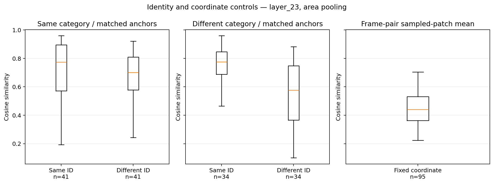
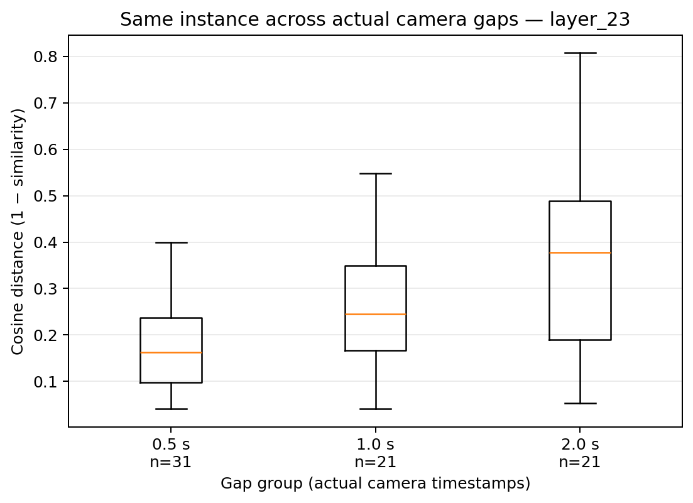
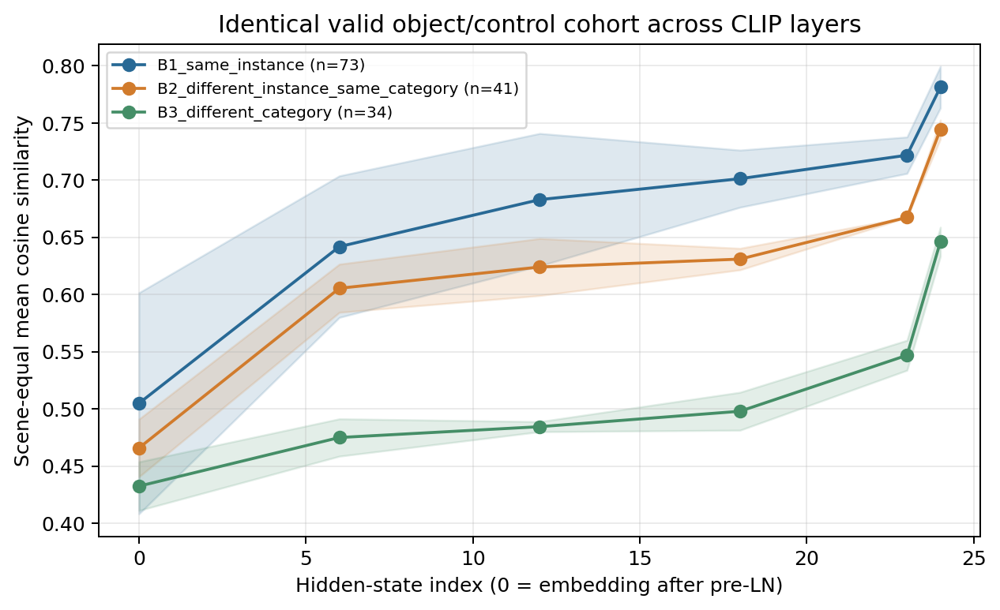
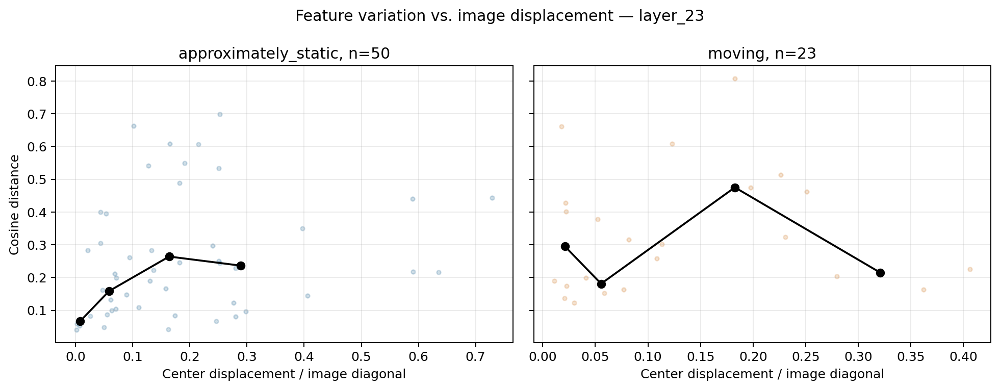
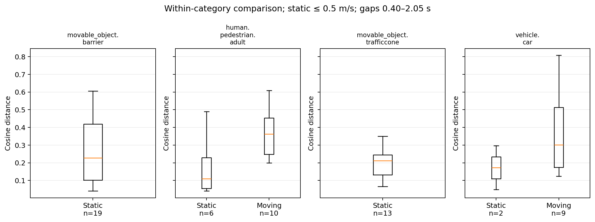
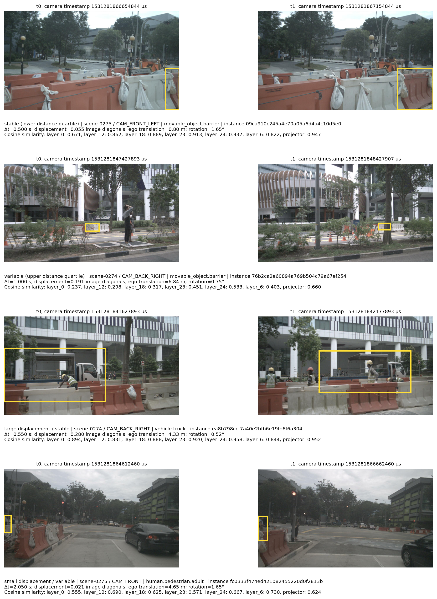

# Experiment 3: Physical Identity vs. Representation Stability


## Research question and scope


Test whether official physical identity implies invariant intermediate visual representations across continuous camera observations. Q1–Q5 cover same-ID variation, observation conditions, CLIP layers, approximate motion strata and matched different-ID baselines. All images undergo original full-image visual forwards. This is a motivation observation, with no WorldStream implementation or task-accuracy evaluation.


## Reproducibility and original model


- Senna Git commit: `8428d6689aefd25ed0d1b629d54fc34d1e75061b`; source/input hashes and weight file identities: `metadata/run_metadata.json`.

- Checkpoint: `/data/qh/phdCode/work4/models/Senna`; loaded class `SennaLlavaLlamaForCausalLM`.

- Tower: `CLIPVisionTower`, `/data/qh/phdCode/work4/models/clip-vit-large-patch14-336`; 24 transformer blocks, hidden dimension 1024, patch size 14, image size 336.

- Actual device/precision: `cuda:0` / `torch.float16`; GPU `NVIDIA GeForce RTX 3090`.

- Selected feature `patch`, configured layer -2, resolved hidden-state index 23.

- Camera order: FRONT, FRONT LEFT, FRONT RIGHT, BACK LEFT, BACK RIGHT, BACK. Each camera is encoded independently before original per-view token compression.


```text

Sequential(
  (0): Linear(in_features=1024, out_features=4096, bias=True)
  (1): GELU(approximate='none')
  (2): Linear(in_features=4096, out_features=4096, bias=True)
)

img_adapter(
  (adapter): Sequential(
    (0): Linear(in_features=576, out_features=128, bias=True)
    (1): GELU(approximate='none')
    (2): Linear(in_features=128, out_features=128, bias=True)
    (3): GELU(approximate='none')
    (4): Linear(in_features=128, out_features=128, bias=True)
  )
)

```


Learned token-axis Linear/GELU network; globally mixes 576 into 128 tokens. Only global analysis permitted.

Projector descriptors are collected before the img_adapter. The adapter output is summarized globally in `data/global_stability.csv`; it never receives bounding-box patch indices.


## Original image preprocessing and exact spatial mapping


Model aspect-ratio strategy: `pad`. Original `llava.mm_utils.process_images` performs mean-color square padding, processor resize, center crop, rescale and normalization. Processor configuration:


```json

{
  "_processor_class": null,
  "feature_extractor_type": "CLIPFeatureExtractor",
  "do_resize": true,
  "size": {
    "shortest_edge": 336
  },
  "resample": 3,
  "do_center_crop": true,
  "crop_size": {
    "height": 336,
    "width": 336
  },
  "do_rescale": true,
  "rescale_factor": 0.00392156862745098,
  "do_normalize": true,
  "image_mean": [
    0.48145466,
    0.4578275,
    0.40821073
  ],
  "image_std": [
    0.26862954,
    0.26130258,
    0.27577711
  ],
  "do_convert_rgb": true,
  "image_processor_type": "CLIPImageProcessor"
}

```


Every image records its original dimensions, integer padding/crop offsets and rounded resize dimensions in its feature shard and `object_patch_mapping.csv`. Runtime input dimensions are compared with the recorded transform. Boxes are clipped to the actual input region; completely removed, low-retention and insufficient-patch objects are excluded and counted.

Area pooling requires intersection/patch area ≥ 0.25, at least 2 patches, retained bbox area ≥ 0.5. Row-major patch indices exclude CLS. Mean pooling uses the same qualifying patches; center pooling uses contained centers. Grid [24, 24] is derived from the actual vision configuration and validated against tensor token counts.


## Layer indexing and actual output shapes


CLIP hidden_states[0] is embedding+position after pre_layernorm, before transformer block 1


| layer | shape | dtype | spatial_mapping |
| --- | --- | --- | --- |
| layer_0 | [1, 577, 1024] | torch.float16 | True |
| layer_6 | [1, 577, 1024] | torch.float16 | True |
| layer_12 | [1, 577, 1024] | torch.float16 | True |
| layer_18 | [1, 577, 1024] | torch.float16 | True |
| layer_23 | [1, 577, 1024] | torch.float16 | True |
| layer_24 | [1, 577, 1024] | torch.float16 | True |
| projector | [1, 576, 4096] | torch.float16 | True |
| adapter_global | [1, 128, 4096] | torch.float16 | False |


Configured early/middle/late/terminal hidden states and the resolved Senna-selected state are extracted with `output_hidden_states=True` through transparent forward hooks. Hooks return None. All-layer comparisons use an identical valid comparison cohort, separately by aggregation method and control group.


## Forward correctness and numerical control


3 batches compared original and instrumented Vision Tower + compressed visual outputs; all passed: True. Absolute tolerance 0.001, relative tolerance 0.001. Full shape/dtype/max-error checks and repeated object-descriptor metrics: `metadata/output_equivalence.json`.

Repeated-input selected-layer descriptor controls: n=51, maximum cosine distance=1.1920928955078125e-07. Aggregation and distances use FP32; saved descriptors use FP16. Nonfinite and near-zero norms are explicitly labeled, not replaced with zero.


## Official identity pairs, selection and missingness


E2 matched records: 40043; selected-scene candidates 11886; quality-filtered 764 (6.43%); eligible 11122; selected 100; sampling omissions 11022; unique physical instances 71.

Actual scenes 2, cameras ['CAM_BACK', 'CAM_BACK_LEFT', 'CAM_BACK_RIGHT', 'CAM_FRONT', 'CAM_FRONT_LEFT', 'CAM_FRONT_RIGHT'], camera gaps {'min': 0.4, 'max': 2.1, 'median': 1.0}. Scene list: `metadata/scene_list.json`.

seeded round robin over scene/camera/category/gap/motion/area/displacement/ego strata; descriptive selected cohort, not population estimate

Per-scene, camera, category, gap and motion counts before/after selection and all quality exclusions are saved in `metadata/pair_selection.json`. Sample selection is not representative of the whole nuScenes population.

Identity is checked against E2 projected official annotations at both endpoints with exact scene/camera/instance/sample-data tokens, category, bbox and actual image existence. Similarity time uses camera exposures; approximate object speed uses annotation-center displacement over sample timestamp gaps.


| aggregation | mapping_status | n |
| --- | --- | --- |
| area | insufficient_patches | 709 |
| area | valid | 1500 |
| center | insufficient_patches | 976 |
| center | valid | 1233 |
| mean | insufficient_patches | 709 |
| mean | valid | 1500 |


## Same identity and matched comparison baselines


B1 compares same official instance over time. B2 changes identity within the exact category; B3 changes category. Both use the same anchor, scene, camera and exact target frame, with target area and reliable depth ratios bounded by predeclared constraints. Unmatched anchors are explicitly recorded, and controls can be reused across anchors. B4 compares predeclared fixed spatial patch centers in two frames, excluding padded-content centers; summary first averages sampled patches per frame pair.

| comparison_group | metric | n | mean | p50 | std | p25 | p75 | p90 | p95 | scene_equal_weight_mean | ci95_low | ci95_high |
| --- | --- | --- | --- | --- | --- | --- | --- | --- | --- | --- | --- | --- |
| B1_same_instance | cosine_similarity | 73 | 0.72334 | 0.77737 | 0.18635 | 0.60017 | 0.86345 | 0.91913 | 0.94348 | 0.72182 | 0.70589 | 0.73774 |
| B1_same_instance | cosine_distance | 73 | 0.27666 | 0.22263 | 0.18635 | 0.13655 | 0.39983 | 0.54717 | 0.62976 | 0.27818 | 0.26226 | 0.29411 |
| B1_same_instance | relative_l2_error | 73 | 0.74336 | 0.71447 | 0.28373 | 0.5531 | 0.94839 | 1.1455 | 1.1931 | 0.74715 | 0.70764 | 0.78665 |
| B2_different_instance_same_category | cosine_similarity | 41 | 0.6675 | 0.70182 | 0.19386 | 0.57829 | 0.80985 | 0.88879 | 0.90597 | 0.66747 | 0.66732 | 0.66763 |
| B2_different_instance_same_category | cosine_distance | 41 | 0.3325 | 0.29818 | 0.19386 | 0.19015 | 0.42171 | 0.6074 | 0.72025 | 0.33253 | 0.33237 | 0.33268 |
| B2_different_instance_same_category | relative_l2_error | 41 | 0.80625 | 0.78358 | 0.23643 | 0.64311 | 0.96992 | 1.1442 | 1.1564 | 0.80559 | 0.80173 | 0.80945 |
| B3_different_category | cosine_similarity | 34 | 0.54383 | 0.57653 | 0.23396 | 0.3666 | 0.74803 | 0.82421 | 0.8424 | 0.54691 | 0.53381 | 0.56001 |
| B3_different_category | cosine_distance | 34 | 0.45617 | 0.42347 | 0.23396 | 0.25197 | 0.6334 | 0.78727 | 0.85642 | 0.45309 | 0.43999 | 0.46619 |
| B3_different_category | relative_l2_error | 34 | 0.88889 | 0.92663 | 0.21514 | 0.6944 | 1.0441 | 1.1006 | 1.2595 | 0.88281 | 0.85697 | 0.90865 |


Matched same-minus-different similarity margins use the same anchors, not subtraction of unrelated population means:


| control_group | n | mean | p50 | ci95_low | ci95_high |
| --- | --- | --- | --- | --- | --- |
| B2_different_instance_same_category | 41 | 0.050412 | 0.040798 | 0.040399 | 0.057505 |
| B3_different_category | 34 | 0.2025 | 0.14345 | 0.19031 | 0.21005 |


Matched-cohort overlap and descriptive AUC (no fitted classifier):


| layer_id | aggregation | control_group | n | histogram_overlap | descriptive_auc |
| --- | --- | --- | --- | --- | --- |
| layer_0 | area | B2_different_instance_same_category | 41 | 0.4878 | 0.50565 |
| layer_0 | area | B3_different_category | 34 | 0.47059 | 0.61246 |
| layer_0 | center | B2_different_instance_same_category | 33 | 0.48485 | 0.52525 |
| layer_0 | center | B3_different_category | 27 | 0.59259 | 0.58162 |
| layer_0 | mean | B2_different_instance_same_category | 41 | 0.60976 | 0.51071 |
| layer_0 | mean | B3_different_category | 34 | 0.47059 | 0.62543 |
| layer_12 | area | B2_different_instance_same_category | 41 | 0.4878 | 0.58477 |
| layer_12 | area | B3_different_category | 34 | 0.44118 | 0.80277 |
| layer_12 | center | B2_different_instance_same_category | 33 | 0.60606 | 0.62259 |
| layer_12 | center | B3_different_category | 27 | 0.37037 | 0.81207 |
| layer_12 | mean | B2_different_instance_same_category | 41 | 0.56098 | 0.57674 |
| layer_12 | mean | B3_different_category | 34 | 0.32353 | 0.79152 |
| layer_18 | area | B2_different_instance_same_category | 41 | 0.53659 | 0.62403 |
| layer_18 | area | B3_different_category | 34 | 0.38235 | 0.78893 |
| layer_18 | center | B2_different_instance_same_category | 33 | 0.54545 | 0.66116 |
| layer_18 | center | B3_different_category | 27 | 0.33333 | 0.77503 |
| layer_18 | mean | B2_different_instance_same_category | 41 | 0.53659 | 0.61779 |
| layer_18 | mean | B3_different_category | 34 | 0.47059 | 0.75087 |
| layer_23 | area | B2_different_instance_same_category | 41 | 0.53659 | 0.58715 |
| layer_23 | area | B3_different_category | 34 | 0.47059 | 0.76211 |
| layer_23 | center | B2_different_instance_same_category | 33 | 0.54545 | 0.62902 |
| layer_23 | center | B3_different_category | 27 | 0.48148 | 0.75995 |
| layer_23 | mean | B2_different_instance_same_category | 41 | 0.53659 | 0.57852 |
| layer_23 | mean | B3_different_category | 34 | 0.5 | 0.71972 |
| layer_24 | area | B2_different_instance_same_category | 41 | 0.60976 | 0.57466 |
| layer_24 | area | B3_different_category | 34 | 0.47059 | 0.76557 |
| layer_24 | center | B2_different_instance_same_category | 33 | 0.63636 | 0.60882 |
| layer_24 | center | B3_different_category | 27 | 0.51852 | 0.75995 |
| layer_24 | mean | B2_different_instance_same_category | 41 | 0.58537 | 0.57139 |
| layer_24 | mean | B3_different_category | 34 | 0.55882 | 0.71194 |
| layer_6 | area | B2_different_instance_same_category | 41 | 0.58537 | 0.54491 |
| layer_6 | area | B3_different_category | 34 | 0.38235 | 0.78547 |
| layer_6 | center | B2_different_instance_same_category | 33 | 0.60606 | 0.56107 |
| layer_6 | center | B3_different_category | 27 | 0.33333 | 0.79561 |
| layer_6 | mean | B2_different_instance_same_category | 41 | 0.4878 | 0.53807 |
| layer_6 | mean | B3_different_category | 34 | 0.44118 | 0.77941 |
| projector | area | B2_different_instance_same_category | 41 | 0.60976 | 0.60202 |
| projector | area | B3_different_category | 34 | 0.41176 | 0.76903 |
| projector | center | B2_different_instance_same_category | 33 | 0.54545 | 0.63269 |
| projector | center | B3_different_category | 27 | 0.33333 | 0.76269 |

Showing 40/42 rows; full values are in the accompanying CSV/JSON.


## Actual time-gap distributions


| time_gap_group | metric | n | mean | p50 | p95 | ci95_low | ci95_high |
| --- | --- | --- | --- | --- | --- | --- | --- |
| 0.5 | cosine_similarity | 31 | 0.77954 | 0.83716 | 0.94637 | 0.72277 | 0.84849 |
| 0.5 | cosine_distance | 31 | 0.22046 | 0.16284 | 0.60763 | 0.15151 | 0.27723 |
| 0.5 | relative_l2_error | 31 | 0.64968 | 0.6183 | 1.0803 | 0.55284 | 0.72943 |
| 1.0 | cosine_similarity | 21 | 0.72242 | 0.75524 | 0.91762 | 0.68842 | 0.75333 |
| 1.0 | cosine_distance | 21 | 0.27758 | 0.24476 | 0.5487 | 0.24667 | 0.31158 |
| 1.0 | relative_l2_error | 21 | 0.7604 | 0.73254 | 1.2212 | 0.68937 | 0.83853 |
| 2.0 | cosine_similarity | 21 | 0.6413 | 0.62184 | 0.92699 | 0.62295 | 0.68716 |
| 2.0 | cosine_distance | 21 | 0.3587 | 0.37816 | 0.66241 | 0.31284 | 0.37705 |
| 2.0 | relative_l2_error | 21 | 0.86462 | 0.91063 | 1.1743 | 0.86234 | 0.86553 |

Different gaps also involve different viewpoints, projected scales and scene content; this does not isolate a pure temporal-decay effect.


## Image displacement, ego motion and observation conditions


Normalized displacement is E2 bbox-center Euclidean migration divided by original image diagonal. Displacement, translation, rotation, yaw, depth, area, scale ratio and geometric projection quality are retained. `observation_condition_stability.csv` stratifies category, motion and time; `condition_correlations.json` reports descriptive observation Spearman and scene-median bootstrap intervals.

| category_name | motion_group | time_gap_group | variable | n | scenes | observation_spearman | scene_median_spearman |
| --- | --- | --- | --- | --- | --- | --- | --- |
| human.pedestrian.adult | approximately_static | 0.5 | normalized_displacement | 2 | 1 | unavailable | unavailable |
| human.pedestrian.adult | approximately_static | 0.5 | ego_translation_m | 2 | 1 | unavailable | unavailable |
| human.pedestrian.adult | approximately_static | 0.5 | ego_rotation_deg | 2 | 1 | unavailable | unavailable |
| human.pedestrian.adult | approximately_static | 0.5 | ego_yaw_change_deg | 2 | 1 | unavailable | unavailable |
| human.pedestrian.adult | approximately_static | 0.5 | bbox_scale_ratio | 2 | 1 | unavailable | unavailable |
| human.pedestrian.adult | approximately_static | 2.0 | normalized_displacement | 4 | 2 | 0.8 | unavailable |
| human.pedestrian.adult | approximately_static | 2.0 | ego_translation_m | 4 | 2 | 0.8 | unavailable |
| human.pedestrian.adult | approximately_static | 2.0 | ego_rotation_deg | 4 | 2 | 1 | unavailable |
| human.pedestrian.adult | approximately_static | 2.0 | ego_yaw_change_deg | 4 | 2 | -1 | unavailable |
| human.pedestrian.adult | approximately_static | 2.0 | bbox_scale_ratio | 4 | 2 | 0.8 | unavailable |
| human.pedestrian.adult | moving | 0.5 | normalized_displacement | 4 | 2 | 0.4 | unavailable |
| human.pedestrian.adult | moving | 0.5 | ego_translation_m | 4 | 2 | 0.2 | unavailable |
| human.pedestrian.adult | moving | 0.5 | ego_rotation_deg | 4 | 2 | -0.4 | unavailable |
| human.pedestrian.adult | moving | 0.5 | ego_yaw_change_deg | 4 | 2 | -0.2 | unavailable |
| human.pedestrian.adult | moving | 0.5 | bbox_scale_ratio | 4 | 2 | 1 | unavailable |
| human.pedestrian.adult | moving | 1.0 | normalized_displacement | 2 | 2 | unavailable | unavailable |
| human.pedestrian.adult | moving | 1.0 | ego_translation_m | 2 | 2 | unavailable | unavailable |
| human.pedestrian.adult | moving | 1.0 | ego_rotation_deg | 2 | 2 | unavailable | unavailable |
| human.pedestrian.adult | moving | 1.0 | ego_yaw_change_deg | 2 | 2 | unavailable | unavailable |
| human.pedestrian.adult | moving | 1.0 | bbox_scale_ratio | 2 | 2 | unavailable | unavailable |
| human.pedestrian.adult | moving | 2.0 | normalized_displacement | 4 | 1 | -0.4 | unavailable |
| human.pedestrian.adult | moving | 2.0 | ego_translation_m | 4 | 1 | -1 | unavailable |
| human.pedestrian.adult | moving | 2.0 | ego_rotation_deg | 4 | 1 | 1 | unavailable |
| human.pedestrian.adult | moving | 2.0 | ego_yaw_change_deg | 4 | 1 | -1 | unavailable |
| human.pedestrian.adult | moving | 2.0 | bbox_scale_ratio | 4 | 1 | -0.4 | unavailable |
| human.pedestrian.construction_worker | approximately_static | 0.5 | normalized_displacement | 1 | 1 | unavailable | unavailable |
| human.pedestrian.construction_worker | approximately_static | 0.5 | ego_translation_m | 1 | 1 | unavailable | unavailable |
| human.pedestrian.construction_worker | approximately_static | 0.5 | ego_rotation_deg | 1 | 1 | unavailable | unavailable |
| human.pedestrian.construction_worker | approximately_static | 0.5 | ego_yaw_change_deg | 1 | 1 | unavailable | unavailable |
| human.pedestrian.construction_worker | approximately_static | 0.5 | bbox_scale_ratio | 1 | 1 | unavailable | unavailable |
| human.pedestrian.construction_worker | moving | 0.5 | normalized_displacement | 2 | 1 | unavailable | unavailable |
| human.pedestrian.construction_worker | moving | 0.5 | ego_translation_m | 2 | 1 | unavailable | unavailable |
| human.pedestrian.construction_worker | moving | 0.5 | ego_rotation_deg | 2 | 1 | unavailable | unavailable |
| human.pedestrian.construction_worker | moving | 0.5 | ego_yaw_change_deg | 2 | 1 | unavailable | unavailable |
| human.pedestrian.construction_worker | moving | 0.5 | bbox_scale_ratio | 2 | 1 | unavailable | unavailable |
| human.pedestrian.construction_worker | moving | 1.0 | normalized_displacement | 1 | 1 | unavailable | unavailable |
| human.pedestrian.construction_worker | moving | 1.0 | ego_translation_m | 1 | 1 | unavailable | unavailable |
| human.pedestrian.construction_worker | moving | 1.0 | ego_rotation_deg | 1 | 1 | unavailable | unavailable |
| human.pedestrian.construction_worker | moving | 1.0 | ego_yaw_change_deg | 1 | 1 | unavailable | unavailable |
| human.pedestrian.construction_worker | moving | 1.0 | bbox_scale_ratio | 1 | 1 | unavailable | unavailable |

Showing 40/130 rows; full values are in the accompanying CSV/JSON.

These associations do not identify causal effects of position embeddings, ego motion or elapsed time. Geometric image-clipping ratios are not occlusion rates; official visibility labels are not precise masks.


## Across-layer stability


| layer_id | comparison_group | n | p50 | mean | ci95_low | ci95_high |
| --- | --- | --- | --- | --- | --- | --- |
| layer_0 | B1_same_instance | 73 | 0.49186 | 0.4858 | 0.39841 | 0.59172 |
| layer_0 | B2_different_instance_same_category | 41 | 0.5124 | 0.52982 | 0.50892 | 0.55932 |
| layer_0 | B3_different_category | 34 | 0.58239 | 0.5725 | 0.54624 | 0.58876 |
| layer_12 | B1_same_instance | 73 | 0.28556 | 0.31146 | 0.25914 | 0.37489 |
| layer_12 | B2_different_instance_same_category | 41 | 0.34455 | 0.37168 | 0.35099 | 0.40088 |
| layer_12 | B3_different_category | 34 | 0.49803 | 0.51448 | 0.5111 | 0.51993 |
| layer_18 | B1_same_instance | 73 | 0.24666 | 0.29632 | 0.27373 | 0.3237 |
| layer_18 | B2_different_instance_same_category | 41 | 0.32444 | 0.3674 | 0.35959 | 0.37842 |
| layer_18 | B3_different_category | 34 | 0.4623 | 0.50593 | 0.48544 | 0.51861 |
| layer_23 | B1_same_instance | 73 | 0.22263 | 0.27666 | 0.26226 | 0.29411 |
| layer_23 | B2_different_instance_same_category | 41 | 0.29818 | 0.3325 | 0.33237 | 0.33268 |
| layer_23 | B3_different_category | 34 | 0.42347 | 0.45617 | 0.43999 | 0.46619 |
| layer_24 | B1_same_instance | 73 | 0.17387 | 0.21697 | 0.20054 | 0.23688 |
| layer_24 | B2_different_instance_same_category | 41 | 0.20398 | 0.25433 | 0.24743 | 0.26408 |
| layer_24 | B3_different_category | 34 | 0.34907 | 0.35682 | 0.34116 | 0.36651 |
| layer_6 | B1_same_instance | 73 | 0.38078 | 0.35218 | 0.29623 | 0.42 |
| layer_6 | B2_different_instance_same_category | 41 | 0.42495 | 0.3909 | 0.37343 | 0.41557 |
| layer_6 | B3_different_category | 34 | 0.51741 | 0.52115 | 0.50866 | 0.54133 |
| projector | B1_same_instance | 73 | 0.17925 | 0.2486 | 0.24581 | 0.2509 |
| projector | B2_different_instance_same_category | 41 | 0.25425 | 0.32461 | 0.28928 | 0.34963 |
| projector | B3_different_category | 34 | 0.43691 | 0.51889 | 0.50844 | 0.53577 |


## Approximately static and moving objects


Main threshold ≤ 0.5 m/s; sensitivity thresholds [0.2, 0.5, 1.0]. Nonfinite speed is Unknown. NuScenes annotation-center velocities may contain noise and do not identify unannotated roads/buildings as static instances.

| category_name | motion_group | time_gap_group | n | mean | p50 | ci95_low | ci95_high |
| --- | --- | --- | --- | --- | --- | --- | --- |
| human.pedestrian.adult | approximately_static | 0.5 | 2 | 0.049616 | 0.049616 | unavailable | unavailable |
| human.pedestrian.adult | approximately_static | 2.0 | 4 | 0.23864 | 0.20632 | 0.23456 | 0.2509 |
| human.pedestrian.adult | moving | 0.5 | 4 | 0.23621 | 0.215 | 0.215 | 0.25741 |
| human.pedestrian.adult | moving | 1.0 | 2 | 0.46853 | 0.46853 | 0.46184 | 0.47522 |
| human.pedestrian.adult | moving | 2.0 | 4 | 0.44078 | 0.415 | unavailable | unavailable |
| human.pedestrian.construction_worker | approximately_static | 0.5 | 1 | 0.084413 | 0.084413 | unavailable | unavailable |
| human.pedestrian.construction_worker | moving | 0.5 | 2 | 0.15773 | 0.15773 | unavailable | unavailable |
| human.pedestrian.construction_worker | moving | 1.0 | 1 | 0.25867 | 0.25867 | unavailable | unavailable |
| movable_object.barrier | approximately_static | 0.5 | 7 | 0.19828 | 0.12327 | 0.14033 | 0.27555 |
| movable_object.barrier | approximately_static | 1.0 | 9 | 0.24642 | 0.24476 | 0.16388 | 0.41151 |
| movable_object.barrier | approximately_static | 2.0 | 3 | 0.45757 | 0.4428 | 0.4428 | 0.46496 |
| movable_object.trafficcone | approximately_static | 0.5 | 8 | 0.27532 | 0.20546 | 0.17946 | 0.4351 |
| movable_object.trafficcone | approximately_static | 1.0 | 4 | 0.23193 | 0.21697 | 0.14377 | 0.26131 |
| movable_object.trafficcone | approximately_static | 2.0 | 1 | 0.073013 | 0.073013 | unavailable | unavailable |
| static_object.bicycle_rack | approximately_static | 0.5 | 1 | 0.60881 | 0.60881 | unavailable | unavailable |
| static_object.bicycle_rack | approximately_static | 2.0 | 1 | 0.66241 | 0.66241 | unavailable | unavailable |
| vehicle.bus.rigid | approximately_static | 2.0 | 1 | 0.19013 | 0.19013 | unavailable | unavailable |
| vehicle.bus.rigid | moving | 2.0 | 1 | 0.13655 | 0.13655 | unavailable | unavailable |
| vehicle.car | approximately_static | 0.5 | 1 | 0.048457 | 0.048457 | unavailable | unavailable |
| vehicle.car | approximately_static | 2.0 | 1 | 0.29665 | 0.29665 | unavailable | unavailable |
| vehicle.car | moving | 1.0 | 5 | 0.29759 | 0.18931 | 0.1817 | 0.37484 |
| vehicle.car | moving | 2.0 | 4 | 0.45562 | 0.44581 | 0.12329 | 0.56639 |
| vehicle.construction | approximately_static | 0.5 | 1 | 0.28385 | 0.28385 | unavailable | unavailable |
| vehicle.construction | approximately_static | 2.0 | 1 | 0.26107 | 0.26107 | unavailable | unavailable |
| vehicle.motorcycle | approximately_static | 0.5 | 2 | 0.31123 | 0.31123 | unavailable | unavailable |
| vehicle.truck | approximately_static | 0.5 | 2 | 0.11801 | 0.11801 | unavailable | unavailable |

Motion comparisons are within category and actual gap groups; remaining scale/depth/viewpoint and annotation differences prevent a causal interpretation.


## Object-scale and patch-aggregation sensitivity


| aggregation | minimum_patch_count | n | mean | p50 | ci95_low | ci95_high |
| --- | --- | --- | --- | --- | --- | --- |
| area | 2 | 73 | 0.27666 | 0.22263 | 0.26226 | 0.29411 |
| center | 2 | 64 | 0.27459 | 0.23766 | 0.25402 | 0.30103 |
| mean | 2 | 73 | 0.2787 | 0.23667 | 0.26213 | 0.29879 |
| area | 4 | 43 | 0.20136 | 0.16247 | 0.162 | 0.25107 |
| center | 4 | 33 | 0.20895 | 0.20191 | 0.16474 | 0.26895 |
| mean | 4 | 43 | 0.20241 | 0.1611 | 0.15984 | 0.25619 |
| area | 8 | 26 | 0.16932 | 0.15863 | 0.13562 | 0.23296 |
| center | 8 | 23 | 0.1859 | 0.15095 | 0.14176 | 0.26867 |
| mean | 8 | 26 | 0.16638 | 0.15148 | 0.12983 | 0.23543 |

Full area-bin summaries: `data/area_sensitivity.csv`; pooling/patch-count summaries: `data/patch_sensitivity.csv`. Minimum-patch sensitivity only tightens the primary filter; samples rejected by the configured primary patch minimum are not silently reintroduced.


## Statistical uncertainty and limitations


Bootstrap scene-equal means, not independent objects/frames. A single-scene CI is unavailable. Quantiles and AUC are descriptive. Condition associations are not causal.

Repeated objects, shared frames, cross-camera observations and reused negatives are correlated. The number of scenes limits inference. Axis-aligned projected 3D-box rectangles include background and do not establish unobstructed visibility. CLIP patch states depend on global self-attention. Offline pooled descriptors are not native object tokens or pure object semantics. Conclusions apply to the sampled checkpoint, precision and cohort.


## Figures and qualitative examples


Qualitative selection uses lower/upper feature-distance quartiles and large/small displacement quartiles, choosing cases nearest each within-condition median; remaining examples are seeded references. Missing conditions are reported rather than manufactured.

Unavailable qualitative conditions: [].




















## Reproduction


```bash

/home/qh/miniconda3/envs/Senna/bin/python experiments/motivation_exp3/run_exp3.py \

  --config experiments/motivation_exp3/config.yaml --run-all

```


Resolved configuration: `metadata/experiment_config.yaml`; use its paths/limits to reproduce this particular cohort. `--smoke-test` uses a separate output directory, at most 2 scenes and 100 object pairs. Valid offline feature shards are reused only to resume this offline experiment; every distinct image represented in the experiment was originally fully encoded.


## A. Observation Supported by Evidence


In the selected cohort, 73 valid same-instance pairs at layer_23 have cosine-distance median 0.22263, P95 0.62976, and relative-L2 median 0.71447. The maximum repeated-input object-descriptor cosine distance is 1.1921e-07 (51 controls); 100.0% of same-instance pairs exceed that empirical numerical envelope plus 1e-6. These measurements support non-invariance of the sampled bbox-pooled intermediate representations despite official identity persistence. They do not establish a universal or task-relevant error threshold.


Matched identity margins and overlapping baseline distributions above characterize identity discrimination separately from high absolute cosine similarity. No monotone layer/time/motion effect is presumed.


## B. Claims Not Established


This experiment does not establish that historical visual features cannot be cached; that a similarity decline implies driving-accuracy loss; or that any feature-error cutoff is an optimal reuse threshold. It does not establish that World Alignment resolves variation, that WorldStream State Validity works, that reuse reduces FLOPs by a particular amount, that incremental execution accelerates a GPU, or that a Deadline Scheduler is necessary. No features were replaced, no historical inference computations were reused, and no model was trained or fine-tuned.